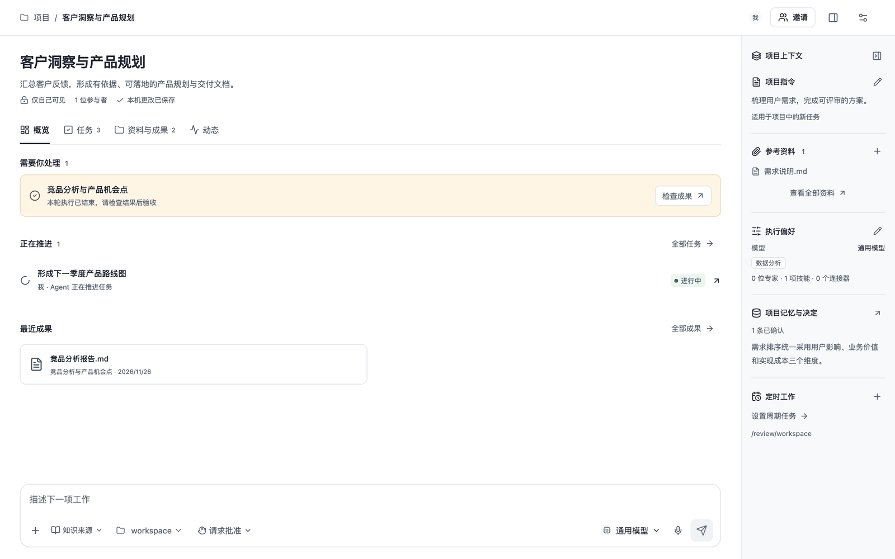
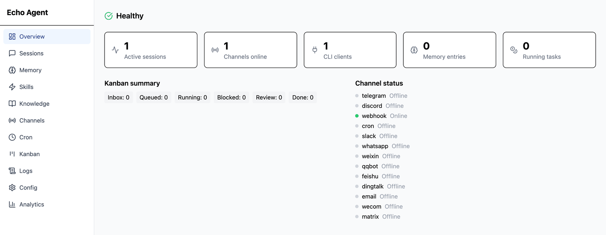

<div align="center">

<h1></h1>

**Echo Agent is an AI assistant with cross-session memory. Use it on your desktop to work with documents, code, and web pages, run it in your terminal, or self-host it to connect with WeChat, Feishu, and Slack.**

<p>
  <a href="#desktop"></a>
  &nbsp;
  <a href="#runtime"></a>
</p>

[](https://pypi.org/project/echo-agent/)
[](https://github.com/fuyuxiang/echo-agent/actions/workflows/ci.yml)
[](LICENSE)
[](https://github.com/fuyuxiang/echo-agent/stargazers)

<!-- Download badges are refreshed by .github/workflows/download-stats.yml. -->


[](https://github.com/fuyuxiang/echo-agent/actions/workflows/download-stats.yml)

[Docs](https://fuyuxiang.github.io/echo-agent/en/) · [Architecture](docs/concepts/architecture.en.md) · [Changelog](CHANGELOG.md) · [中文](README.md)

</div>

## Quickstart

Use **Desktop** to work with Echo Agent in a graphical workspace on your computer. Run **Runtime** in your terminal or deploy it as a service for messaging channels and API access. Either option works on its own.

### Desktop

1. [Download the installer](https://github.com/fuyuxiang/echo-agent-desktop/releases) for macOS (Apple Silicon or Intel) or Windows x64.
2. Open the app. Under **Settings → Models**, add and test a model connection, or use one provided by your organization.
3. Choose a working folder and permission mode, then submit a task. The conversation shows its progress and results. [Run your first task](docs/desktop/quickstart.en.md)

[](docs/assets/readme/desktop-project.png)

*Desktop project workspace from the current source build, shown in Chinese with sample data.* [Run from source](docs/desktop/installation.en.md#run-from-this-repository)

### Runtime

Run these commands in a Python 3.11+ virtual environment. In the wizard, configure a model and credentials for OpenAI or a compatible API. If the wizard already starts Gateway, skip the last command. [Other providers and platforms](docs/getting-started/installation.en.md)

```bash
python -m pip install "echo-agent[openai]"
echo-agent setup --flow quickstart
echo-agent gateway
```

Once Gateway is running, send your first message in the [Playground](http://127.0.0.1:58123/playground) and check the service status in the [Dashboard](http://127.0.0.1:58123/). For direct terminal use, choose `echo-agent run`. Run one instance per workspace.

[Runtime quickstart](docs/getting-started/quickstart.en.md) · [Full-screen terminal preview](docs/assets/readme/runtime-tui.png)

[](docs/assets/readme/runtime-dashboard.en.png)

*Gateway Dashboard with sample data.*

## Core capabilities

- **Memory across sessions.** New sessions can retrieve relevant summaries, project context, and user preferences. [Memory system](docs/concepts/memory-system.en.md)
- **Desktop tasks and approvals.** Create and preview Word, Excel, PowerPoint, and PDF files, edit code in an authorized folder, or operate a browser and supported desktop apps. Review plans, tool calls, and file changes in the conversation. The selected permission mode governs approvals. [Code tasks](docs/desktop/coding.en.md) · [Office documents](docs/desktop/knowledge-memory.en.md#generate-and-export-documents) · [Platform support and permissions](docs/desktop/automation.en.md)
- **Desktop projects and collaboration.** Projects keep instructions, reference files, and confirmed decisions available for new tasks. You can divide work among experts or schedule jobs. [Collaboration and scheduling](docs/desktop/collaboration-scheduling.en.md) · [Team projects (Chinese)](client/docs/team-projects.md)
- **Messaging and automation.** Runtime supports 14 channels, including WeChat, Feishu, DingTalk, Slack, webhooks, scheduled jobs, and the terminal. Gateway provides HTTP and WebSocket APIs. [Messaging channels](docs/integrations/channels/index.en.md) · [Gateway API](docs/reference/gateway-api.en.md)
- **Skill evolution.** Runtime can propose skill changes from execution records and compare versions against the same evaluation cases. It supports human review and rollback and is off by default. [Skill evolution and evaluation](docs/concepts/evolution-evaluation.en.md)
- **Extensions.** Desktop and Runtime both support MCP. Runtime ships with 35 skills, supports plugins, and accepts tasks delegated by other agents over A2A. There is currently no outbound A2A delegation entry point in the agent runtime. [Skills, plugins, and MCP](docs/runtime-extensions.en.md) · [A2A integration](docs/integrations/a2a.en.md)

## Documentation

- **Desktop** · [Installation and source builds](docs/desktop/installation.en.md) · [Tasks and permissions](docs/desktop/tasks-permissions.en.md) · [Data management](docs/desktop/operations.en.md)
- **Runtime** · [Installation options](docs/getting-started/installation.en.md) · [Background services](docs/operations/background-service.en.md) · [Security model](docs/concepts/security-model.en.md)
- **Architecture and development** · [System architecture](docs/concepts/architecture.en.md) · [Desktop architecture](docs/concepts/desktop-architecture.en.md) · [Repository map](docs/development/repository-map.en.md)

## Contributing

[Contributing guide](CONTRIBUTING.en.md) · [Report an issue](https://github.com/fuyuxiang/echo-agent/issues) · [Discussions](https://github.com/fuyuxiang/echo-agent/discussions) · [QQ group 47572014](https://qm.qq.com/q/JWOPDBNssw) · [Security reporting](SECURITY.md)

## License

The project's original code uses the PolyForm Noncommercial License 1.0.0. Commercial use outside the license requires separate permission. [Full license](LICENSE)
