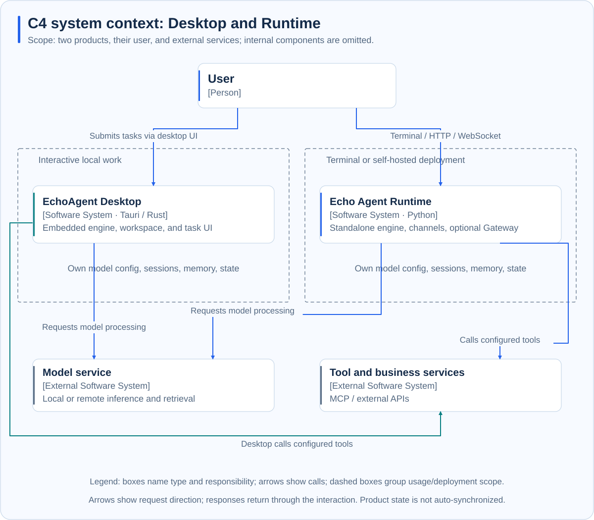
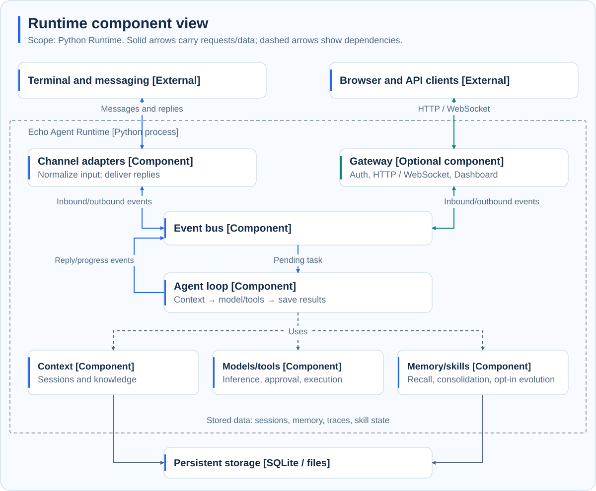

<div align="center">

<h1></h1>

**Give your Agent memory. Turn experience into skills.**

An open-source, self-hosted, embeddable Agent Runtime and a local-first desktop Agent.

<p>
  <a href="#quick-start"></a>
  &nbsp;
  <a href="client/README.en.md#quick-start"></a>
</p>

[Memory & evolution](#long-term-memory-and-skill-evolution) · [Architecture](#architecture-and-runtime-modes) · [Documentation](#documentation) · [中文](README.md)

[](https://pypi.org/project/echo-agent/)
[](https://pypi.org/project/echo-agent/)
[](https://github.com/fuyuxiang/echo-agent/actions/workflows/ci.yml)
[](https://fuyuxiang.github.io/echo-agent/en/)
[](LICENSE)
[](https://github.com/fuyuxiang/echo-agent/stargazers)

<!-- Refreshed daily from the official website by .github/workflows/download-stats.yml. -->
[](http://www.ojlab.com/)
[](http://www.ojlab.com/)
[](http://www.ojlab.com/data/stats.json)

</div>

## Choose Your Starting Point

| Product | When to use it | Start here |
| --- | --- | --- |
| **Echo Agent Runtime** | Build Agents that remember and learn from experience; run in a terminal, deploy a service, or integrate with your application | [Install & deploy](echo-agent-runtime/README.en.md) · [Architecture & runtime modes](#architecture-and-runtime-modes) |
| **EchoAgent Desktop** | Write code, work with documents, and operate browsers and desktop apps in a real workspace, with visible progress and changes | [Install & use](client/README.en.md#quick-start) · [Desktop capabilities](#echoagent-desktop) |

## Quick Start

### Agent Runtime

You need **Python 3.11+** and an API key for at least one model service. Run in your terminal:

```bash
pip install "echo-agent[all]"
echo-agent setup
echo-agent run
```

`setup` configures a model; `run` starts the full Runtime. In mainland China, append `-i https://mirrors.aliyun.com/pypi/simple/` to the installation command if needed. The same commands work in Windows PowerShell; see the [installation guide](https://fuyuxiang.github.io/echo-agent/en/getting-started/installation/) for dependencies and platform limitations.

### Gateway and Dashboard

For web management, API access, or CLI/TUI clients, exit the `run` process above, then start Gateway:

```bash
echo-agent gateway
```

Open **<http://127.0.0.1:58123/>** for Dashboard. Connect to the same Runtime from another terminal:

```bash
echo-agent cli --tui
```

Messaging channels, Webhooks, and scheduled jobs follow configuration. Normally run one full Runtime per workspace; `cli` connects to an existing Gateway without starting another engine. See [runtime modes](https://fuyuxiang.github.io/echo-agent/en/operations/runtime-modes/) and the [Dashboard guide](https://fuyuxiang.github.io/echo-agent/en/guides/dashboard/).

<details>
<summary>Background service and source installation</summary>

On macOS or Linux with systemd, register Gateway as a user-level background service:

```bash
echo-agent gateway install
echo-agent gateway status
echo-agent gateway logs --follow
```

See [background services](https://fuyuxiang.github.io/echo-agent/en/operations/background-service/) for Linux service persistence after logout. Gateway listens on loopback by default; use SSH forwarding for remote access. See [Gateway authentication](https://fuyuxiang.github.io/echo-agent/en/integrations/gateway/authentication/) for authentication settings.

For source deployments, download only `echo-agent-runtime/` and run inside that directory:

```bash
bash scripts/install.sh --source .
```

Pure sources contain the full Dashboard project and require a frontend build. Runtime release archives include prebuilt assets and need no Node/pnpm on the server. The network installation script fetches a sparse checkout of the Runtime. See the [Runtime installation instructions](echo-agent-runtime/README.en.md) for methods, dependencies, and upgrades.

</details>

### EchoAgent Desktop

See the [Desktop quick start](client/README.en.md#quick-start) for installers, supported platforms, and source prerequisites. With this repository already checked out, macOS users can start from its root:

```bash
cd client
pnpm setup:mac
pnpm install --frozen-lockfile
pnpm tauri dev
```

The first launch prepares the embedded Runtime, Theia IDE, and Office Worker. Desktop starts independently and can use the project's built-in remote model service or your own connections. See the [Desktop documentation](client/README.en.md#quick-start) for Windows instructions.

## Long-Term Memory and Skill Evolution

**Cognitive memory carries context across sessions; skill evolution makes execution experience reusable.** These are the two paths in the Runtime:

<!-- Generated by scripts/generate-readme-diagrams.py; review the source mappings there when architecture changes. -->
<p align="center"></p>

### Cognitive Memory

Remember user preferences and project facts across sessions, reducing repeated background explanations. Memory uses **Working, Episodic, Semantic, and Archival** tiers. BM25 and optional vector retrieval combine through RRF. Scope, provenance, and lifecycle eligibility determine what enters the current context; archived, superseded, and unresolved entries are excluded from normal recall.

Background consolidation after replies can extract summaries and facts, resolve contradictions, and apply decay and archival policies. See the [memory system](https://fuyuxiang.github.io/echo-agent/en/concepts/memory-system/) for implementation and configuration.

### Self-Evolving Skills

Generate reusable skill candidates from execution trajectories and reflection, then route them to review or isolated evaluation according to risk and configuration. Only candidates that meet the promotion policy reach the live skill library. Rejections retain their reasons; promoted changes support manual rollback.

The evolution engine is **disabled by default and must be enabled in configuration**. Once enabled, it supports manual, trajectory-threshold, and scheduled triggers. It updates skill content and enabled state; see [evolution and evaluation](https://fuyuxiang.github.io/echo-agent/en/concepts/evolution-evaluation/) for the full process.

## Architecture and Runtime Modes

**Echo Agent Runtime is the shared runtime core**, providing task execution, context, cognitive memory, model access, tools, and skills. Terminal and Gateway host standalone execution; `client/` embeds the Runtime in the desktop application process and adds workspace, IDE, and automation interfaces. Features follow the host integration and configuration.

<p align="center"></p>

### Three Runtime Modes

| Mode | Entry point | Where execution runs |
| --- | --- | --- |
| **Local runtime** | `echo-agent run` | This Runtime process; Gateway is enabled according to configuration |
| **Gateway service** | `echo-agent gateway` | This Runtime process, exposing Dashboard and HTTP/WebSocket APIs |
| **Embedded application** | EchoAgent Desktop or your own host | In the host process; Client connects to its embedded Runtime over ACP channels |

<details>
<summary>Expand the Runtime execution architecture</summary>

<p align="center"></p>

`app.py` composes models, storage, the Agent, channels, scheduling, and optional Gateway, and owns start/stop ordering. `AgentLoop` consumes inbound and publishes outbound events. Tool execution follows admission policies and approval controls. See the [architecture overview](docs/concepts/architecture.en.md) for modules and task flow.

</details>

### Runtime Capabilities

| Capability | Purpose |
| --- | --- |
| **Agent Loop and tasks** | Coordinate inference, tool calls, execution feedback, task state, and planning |
| **Models and routing** | Connect model services and configure routing and fallback |
| **Memory and knowledge** | Recall eligible memories, retrieve knowledge, and assemble task context |
| **Tools and MCP** | Execute local tools and connect external tool services |
| **Skills and Plugins** | Load reusable skills and extend runtime behavior |
| **Automation and channels** | Trigger tasks through scheduled jobs, Webhooks, and configured messaging channels |
| **Permissions and observability** | Govern tool admission and approval; record logs, trajectories, usage, and execution state |

## EchoAgent Desktop

**Put your Agent to work in your workspace.** Desktop uses React, Tauri, and an in-process Echo Agent Runtime to show plans, tool activity, file changes, and deliverables in one application.

| Scenario | Desktop capabilities |
| --- | --- |
| **Coding** | Eclipse Theia IDE, Coding Agent, diff review, verification, and delivery |
| **Browser and desktop control** | Task-isolated Browser Use; explicit Computer Use tasks with pause and resume |
| **Documents and knowledge** | Project files, knowledge indexing, memory, and Word, PDF, Excel, and PowerPoint document workflows |
| **Models and collaboration** | Model connections, MCP, Skills, Plugins, experts, and expert groups |
| **Ongoing work** | Projects and tasks, scheduled automations, and optional WeChat remote sessions |

Browser side effects and desktop tasks use different confirmation flows. Computer Use executes continuously within an authorized task; platform permissions still apply. See the [Desktop README](client/README.en.md), [architecture and data flow](client/README.en.md#architecture-and-data-flow), and [automation platform support](client/docs/automation-platform-support.md) for implementation details and real-device validation scope.

## Extensions and Integration

**Bring Agent capabilities into your application** through a service connection or source-level embedding:

- **Connect to Gateway**: Submit tasks and receive events through the [HTTP / WebSocket API](https://fuyuxiang.github.io/echo-agent/en/reference/gateway-api/). The Runtime service owns models, memory, and execution state.
- **Embed the Runtime from source**: Compose components with [`bootstrap` / `AppRuntime`](echo-agent-runtime/echo_agent/app.py) and let the host manage startup, shutdown, and workspace ownership. Interfaces follow the chosen source version; pin it and validate lifecycle behavior.
- **Study the Desktop host integration**: [`agent_runtime.rs`](client/src-tauri/src/agent_runtime.rs) shows the embedded **Echo Agent Runtime** and typed ACP channels; dependencies are declared in [`Cargo.toml`](client/src-tauri/Cargo.toml).

| Extension | Purpose | Documentation |
| --- | --- | --- |
| Tools / MCP | Add execution capabilities and connect external tools | [Tools](https://fuyuxiang.github.io/echo-agent/en/reference/tools/) · [MCP](https://fuyuxiang.github.io/echo-agent/en/integrations/mcp/) |
| Skills / Plugins | Reuse workflows and extend Runtime behavior | [Skills](https://fuyuxiang.github.io/echo-agent/en/integrations/skills/using-skills/) · [Plugins](https://fuyuxiang.github.io/echo-agent/en/integrations/plugins/using-plugins/) |
| Models / Channels | Connect model services and messaging entry points | [Models](https://fuyuxiang.github.io/echo-agent/en/guides/models/) · [Channels](https://fuyuxiang.github.io/echo-agent/en/integrations/channels/) |
| A2A | Receive inbound tasks; no outbound A2A delegation entry point in the current Agent runtime | [A2A](https://fuyuxiang.github.io/echo-agent/en/integrations/a2a/) |

## Data and Security

Sessions, memory, configuration, and other state stay in the deployment environment. Remote models, external MCP servers, and third-party messaging channels receive data needed for their operations. When browser or computer automation is enabled in Desktop, model input may include page content and screenshots.

Runtime tool calls follow permissions and approval policies. Desktop also controls workspace authorization, permission modes, and task scope. See the [security model](https://fuyuxiang.github.io/echo-agent/en/concepts/security-model/), [hardening guide](https://fuyuxiang.github.io/echo-agent/en/operations/security-hardening/), and [Desktop data and permission boundaries](client/README.en.md#data-and-permission-boundaries) for storage, authentication, and operational boundaries.

## Documentation

Full documentation: [English](https://fuyuxiang.github.io/echo-agent/en/) · [中文文档](https://fuyuxiang.github.io/echo-agent/)

| Topic | Entry points |
| --- | --- |
| Install and start | [Runtime installation](echo-agent-runtime/README.en.md) · [Installation guide](https://fuyuxiang.github.io/echo-agent/en/getting-started/installation/) · [Quick start](https://fuyuxiang.github.io/echo-agent/en/getting-started/quickstart/) |
| Concepts and architecture | [Architecture](docs/concepts/architecture.en.md) · [Agent Loop](https://fuyuxiang.github.io/echo-agent/en/concepts/agent-loop/) · [Memory](https://fuyuxiang.github.io/echo-agent/en/concepts/memory-system/) · [Evolution](https://fuyuxiang.github.io/echo-agent/en/concepts/evolution-evaluation/) |
| Configuration and operations | [Configuration](https://fuyuxiang.github.io/echo-agent/en/reference/configuration/) · [CLI](https://fuyuxiang.github.io/echo-agent/en/reference/cli/) · [Background services](https://fuyuxiang.github.io/echo-agent/en/operations/background-service/) |
| Desktop | [Install and use](client/README.en.md) · [Desktop releases](client/docs/desktop-release.en.md) |
| Versions and compatibility | [Changelog](CHANGELOG.md) · [Compatibility](https://fuyuxiang.github.io/echo-agent/en/reference/compatibility/) |

## Development and Contributing

```text
echo-agent/
├── echo-agent-runtime/   # Standalone Runtime, including Dashboard and skills
├── client/               # Desktop workspace, embedded Runtime, and Theia
├── docs/                 # Documentation site and visual assets
├── scripts/              # Repository maintenance, docs checks, and diagram generation
└── .github/              # CI, releases, and repository automation
```

<details>
<summary>Runtime development environment and checks</summary>

On macOS or Linux:

```bash
git clone https://github.com/fuyuxiang/echo-agent.git
cd echo-agent/echo-agent-runtime
uv venv venv --python 3.11
source venv/bin/activate
uv pip install -e ".[all,dev]"
ruff check .
pytest
```

See [Runtime development](echo-agent-runtime/README.en.md#build-and-validate) for Dashboard builds and independent package checks, and [Desktop development](client/README.en.md#development) for Desktop checks.

</details>

Contributions to the Runtime, bug fixes, tools, Skills, Plugins, channels, and documentation are welcome. See [CONTRIBUTING.en.md](CONTRIBUTING.en.md) and the [repository map](docs/development/repository-map.en.md). The bilingual README architecture diagrams are generated by [`scripts/generate-readme-diagrams.py`](scripts/generate-readme-diagrams.py); review and update diagrams and text when their implementations change.

## Community and Support

- Usage questions and design discussions: [GitHub Discussions](https://github.com/fuyuxiang/echo-agent/discussions)
- Bug reports and feature requests: [GitHub Issues](https://github.com/fuyuxiang/echo-agent/issues)
- Chinese-language chat: [QQ group 47572014](https://qm.qq.com/q/JWOPDBNssw)
- Security vulnerabilities: [GitHub private security reports](https://github.com/fuyuxiang/echo-agent/security/advisories/new); see [SECURITY.md](SECURITY.md) for the disclosure process

## Project Founders

Echo Agent was co-founded by **Yuxiang Fu** and **Yanrong Gao**.

## License

Echo Agent is open source under the [MIT License](LICENSE). See the [third-party notices](client/THIRD_PARTY_NOTICES.md) for licenses of components included in the desktop app.

The FastEmbed compatibility copy bundled with the Runtime is licensed under Apache-2.0. See its [maintenance notes](echo-agent-runtime/echo_agent/_vendor/fastembed/VENDOR.md) for the source and Pillow 13 compatibility changes.
