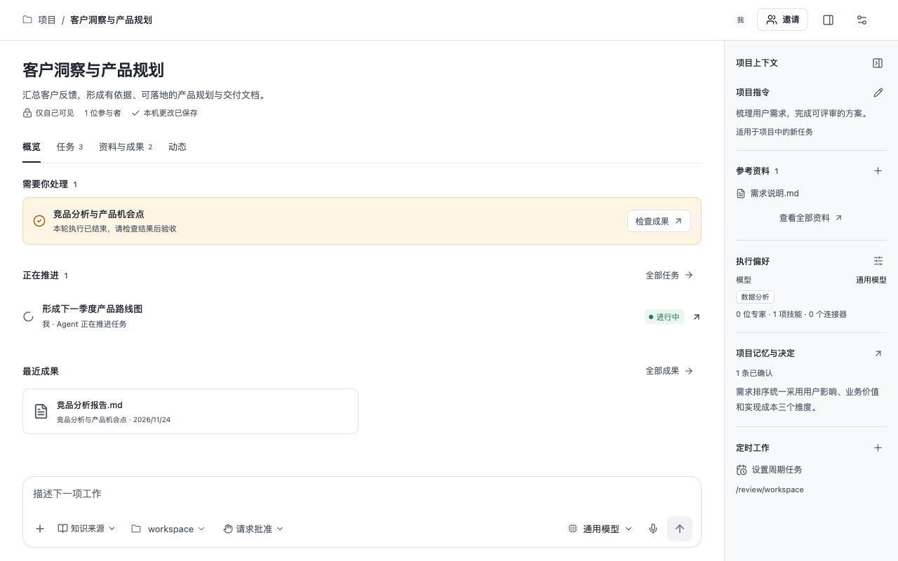

# Echo Agent

Use Echo Agent for code, documents, and recurring work, and keep useful references, results, and context for the next task. On your desktop, track progress and review outputs by project. On your own infrastructure, run scheduled jobs and take requests from messaging channels or your application.

[Download Desktop](https://github.com/fuyuxiang/echo-agent-desktop/releases) · [Run your own agent](#run-your-own-agent) · [Documentation](#documentation) · [中文](README.md)

[](https://pypi.org/project/echo-agent/)
[](https://github.com/fuyuxiang/echo-agent/actions/workflows/ci.yml)
[](LICENSE)

## Work on a project

Say you're preparing a competitive analysis. Add a brief to your project in EchoAgent Desktop and ask the agent to write a report. Open the report under project files and outputs, review it, and attach it to the next task from the preview. New tasks also carry over the project's instructions and confirmed decisions.

[](client/docs/images/echoagent-project-workspace.png)

*EchoAgent Desktop project overview with sample data in the Chinese UI.*

Download the installer for **macOS (Apple Silicon or Intel) or Windows x64**. Under **Settings → Models**, add and test your own model connection or choose an organization-provided model. Select a working folder and a permission mode before submitting a task. [Download Desktop](https://github.com/fuyuxiang/echo-agent-desktop/releases) · [Run your first task](docs/desktop/quickstart.en.md)

- Ask the agent to change code in an authorized folder, then inspect file changes and verification results in the conversation. For document work, generate and open Word, Excel, PowerPoint, or PDF files for review. [Code tasks and file changes](docs/desktop/coding.en.md) · [Office documents](docs/desktop/knowledge-memory.en.md#generate-and-export-documents)
- Have the agent work in a browser or an authorized desktop app. Follow its activity and review permission requests as it runs. [Platform support and permissions](docs/desktop/automation.en.md)
- Choose experts, skills, and MCP connectors for a task, or schedule jobs for a project. Invite teammates through the organization service. [Scheduling](docs/desktop/collaboration-scheduling.en.md) · [Team projects (Chinese)](client/docs/team-projects.md)

## Run your own agent

Run Echo Agent Runtime in a terminal to give the agent a task directly. Deploy it as a service to schedule a weekly report or take requests from messaging channels, webhooks, and your application. [Messaging channels](docs/integrations/channels/index.en.md) · [Gateway API](docs/reference/gateway-api.en.md)

Install in a **Python 3.11+** virtual environment and follow the setup wizard to configure a model. This example uses OpenAI or a compatible API. [Installation for other providers and platforms](docs/getting-started/installation.en.md)

```bash
python -m pip install "echo-agent[openai,tui]"
echo-agent setup --flow quickstart
```

Use `echo-agent run` to start a task in the terminal, or `echo-agent gateway` to start the service. The default URLs are the [Dashboard](http://127.0.0.1:58123/) for management and the [Playground](http://127.0.0.1:58123/playground) for chat. Choose one way to start the Runtime per workspace. If the wizard already started Gateway, open it in your browser or connect with `echo-agent cli`. [Quickstart](docs/getting-started/quickstart.en.md) · [Deployment](echo-agent-runtime/README.en.md)

- **Memory across sessions.** New sessions can retrieve relevant summaries, project facts, and preferences. A weekly report can use the format you saved in an earlier conversation. [Memory system](docs/concepts/memory-system.en.md)
- **Skill evolution.** Runtime can propose skill changes from execution records and compare versions on the same evaluation cases. You can require human review and roll back applied changes. Skill evolution is off by default. [Skill evolution and evaluation](docs/concepts/evolution-evaluation.en.md)

## Documentation

Desktop embeds a Rust engine. The standalone Python Runtime can be installed and deployed on its own. Each manages its own model configuration, sessions, and memory. [System architecture](docs/concepts/architecture.en.md)

- **Desktop** · [Installation and source builds](docs/desktop/installation.en.md) · [User guide](client/README.en.md) · [Data management](docs/desktop/operations.en.md)
- **Runtime** · [Build and deploy](echo-agent-runtime/README.en.md) · [Background services](docs/operations/background-service.en.md) · [Skills, plugins, and MCP](docs/runtime-extensions.en.md) · [Security model](docs/concepts/security-model.en.md)
- **Integration and development** · [API reference](docs/reference/gateway-api.en.md) · [Python Runtime composition](echo-agent-runtime/echo_agent/app.py) · [Repository map](docs/development/repository-map.en.md)

[Full documentation](https://fuyuxiang.github.io/echo-agent/en/) · [Changelog](CHANGELOG.md)

## Contributing

[Contributing guide](CONTRIBUTING.en.md) · [Report an issue](https://github.com/fuyuxiang/echo-agent/issues) · [Discussions](https://github.com/fuyuxiang/echo-agent/discussions) · [QQ group 47572014](https://qm.qq.com/q/JWOPDBNssw) · [Security reporting](SECURITY.md)

## License

The project's original code is source-available under the [PolyForm Noncommercial License 1.0.0](LICENSE). Commercial use outside the license requires separate permission. Previously granted rights remain in effect, and third-party components retain their own licenses. [Earlier MIT notice](LICENSES/MIT.txt) · [Desktop third-party notices](client/THIRD_PARTY_NOTICES.md) · [Bundled FastEmbed licensing](echo-agent-runtime/echo_agent/_vendor/fastembed/VENDOR.md)
