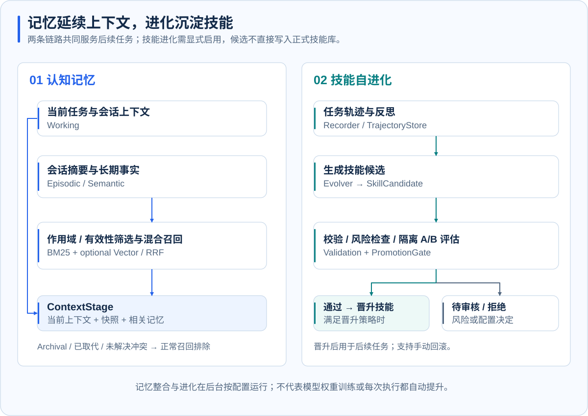

<div align="center">

<h1></h1>

**让 Agent 记住上下文，把经验转化为技能。**

可自托管、可嵌入的开源 Agent Runtime，以及本地优先的桌面 Agent。

<p>
  <a href="#快速开始"></a>
  &nbsp;
  <a href="client/README.md#快速开始"></a>
</p>

[记忆与进化](#长期记忆与技能自进化) · [架构](#架构与运行方式) · [文档](#文档) · [English](README.en.md)

[](https://pypi.org/project/echo-agent/)
[](https://pypi.org/project/echo-agent/)
[](https://github.com/fuyuxiang/echo-agent/actions/workflows/ci.yml)
[](https://fuyuxiang.github.io/echo-agent/)
[](LICENSE)
[](https://github.com/fuyuxiang/echo-agent/stargazers)

<!-- Refreshed daily from the official website by .github/workflows/download-stats.yml. -->
[](http://www.ojlab.com/)
[](http://www.ojlab.com/)
[](http://www.ojlab.com/data/stats.json)

</div>

## 选择你的入口

| 产品 | 适合什么场景 | 从哪里开始 |
| --- | --- | --- |
| **Echo Agent Runtime** | 构建拥有记忆、能积累经验的 Agent；在终端运行、部署服务，或集成到自己的应用 | [安装与部署](echo-agent-runtime/README.md) · [架构与运行方式](#架构与运行方式) |
| **EchoAgent Desktop** | 在真实工作区中编写代码、处理文档、操作浏览器与电脑，并查看执行过程与变更 | [安装与使用](client/README.md#快速开始) · [桌面端能力](#echoagent-desktop) |

## 快速开始

### Agent Runtime

需要 **Python 3.11+**，以及至少一个可用模型服务的 API Key。在终端执行：

```bash
pip install "echo-agent[all]"
echo-agent setup
echo-agent run
```

`setup` 配置模型，`run` 启动完整 Runtime。中国大陆网络环境可在安装命令后添加 `-i https://mirrors.aliyun.com/pypi/simple/`。Windows PowerShell 可使用相同命令；依赖与平台限制见 [安装指南](https://fuyuxiang.github.io/echo-agent/getting-started/installation/)。

### Gateway 与 Dashboard

需要网页管理、API 或 CLI/TUI 接入时，先退出上面的 `run`，再启动 Gateway：

```bash
echo-agent gateway
```

打开 **<http://127.0.0.1:58123/>** 进入 Dashboard。在另一个终端连接同一 Runtime：

```bash
echo-agent cli --tui
```

消息通道、Webhook 和定时任务按配置启用。同一工作区通常只运行一个完整 Runtime；`cli` 连接已有 Gateway，不再启动执行引擎。详见 [运行方式](https://fuyuxiang.github.io/echo-agent/operations/runtime-modes/)与 [Dashboard 指南](https://fuyuxiang.github.io/echo-agent/guides/dashboard/)。

<details>
<summary>后台常驻与源码安装</summary>

在 macOS 或使用 systemd 的 Linux 上，可注册 Gateway 用户级后台服务：

```bash
echo-agent gateway install
echo-agent gateway status
echo-agent gateway logs --follow
```

Linux 退出登录后继续运行的设置见 [后台服务指南](https://fuyuxiang.github.io/echo-agent/operations/background-service/)。Gateway 默认监听本机回环地址，远程接入可使用 SSH 端口转发；认证配置见 [Gateway 认证](https://fuyuxiang.github.io/echo-agent/integrations/gateway/authentication/)。

从源码部署时，只需下载 `echo-agent-runtime/`，在该目录执行：

```bash
bash scripts/install.sh --source .
```

本地源码包含完整 Dashboard 工程，需要前端构建；正式 Runtime 发布压缩包内置前端产物，服务器无需 Node/pnpm。网络安装脚本会获取 Runtime 的稀疏源码。安装方式、依赖与升级步骤见 [Runtime 安装说明](echo-agent-runtime/README.md)。

</details>

### EchoAgent Desktop

安装包、支持平台和源码环境要求见 [桌面端快速开始](client/README.md#快速开始)。已有本仓库源码的 macOS 用户可从仓库根目录启动：

```bash
cd client
pnpm setup:mac
pnpm install --frozen-lockfile
pnpm tauri dev
```

首次运行会准备内嵌 Runtime、Theia IDE 和 Office Worker。桌面端可以独立启动；模型可使用项目内置远端服务，也可自行配置连接。Windows 步骤见 [桌面端文档](client/README.md#快速开始)。

## 长期记忆与技能自进化

**认知记忆延续上下文，技能自进化让执行经验得到复用。** 下图描述 Runtime 中的两条链路：

<!-- Generated by scripts/generate-readme-diagrams.py; review the source mappings there when architecture changes. -->
<p align="center"></p>

### 认知记忆

记住用户偏好与项目事实，跨会话找回相关上下文，减少重复交代背景。记忆按 **Working、Episodic、Semantic、Archival** 分层管理；BM25 与可选向量检索通过 RRF 融合召回。作用域、来源和有效性约束决定哪些内容可以进入本轮上下文，归档、已取代及未解决冲突的条目不参与正常召回。

回复后的后台整合可提取摘要与事实、处理矛盾并执行衰减归档。实现与配置见 [记忆系统](https://fuyuxiang.github.io/echo-agent/concepts/memory-system/)。

### 技能自进化

从执行轨迹和反思中生成可复用的技能候选，按风险与配置进入审核或隔离评估。满足晋升策略的候选才应用到正式技能库；未通过的候选保留拒绝原因，已晋升的变更支持手动回滚。

进化引擎**默认关闭，需配置启用**；启用后可选择手动、轨迹阈值或定时触发。它更新的是技能内容与启用状态，具体流程见 [进化与评估](https://fuyuxiang.github.io/echo-agent/concepts/evolution-evaluation/)。

## 架构与运行方式

**Desktop 与独立 Runtime 采用共同的 Agent 工作方式，当前使用不同的执行引擎。** Python Runtime 提供终端、Gateway、消息通道、记忆与技能进化；Desktop 在进程内嵌入 Rust 引擎，提供工作区、IDE 和自动化界面。两端分别管理模型配置、会话和记忆，不要求先部署另一端。

<p align="center"></p>

### 项目的主要运行方式

| 方式 | 入口 | 执行引擎在哪里 |
| --- | --- | --- |
| **本地运行** | `echo-agent run` | 当前 Runtime 进程；Gateway 是否开放由配置决定 |
| **Gateway 服务** | `echo-agent gateway` | 当前 Runtime 进程，对外开放 Dashboard、HTTP/WebSocket API |
| **桌面应用** | EchoAgent Desktop | 桌面进程内的 Rust 引擎，通过 ACP Channel 与宿主通信 |

<details>
<summary>展开 Runtime 内部执行链路</summary>

<p align="center"></p>

Runtime 装配模型、存储、执行循环、通道、调度和可选 Gateway，并协调启动与停止。入站事件进入任务循环，工具执行受准入与审批控制，结果通过入口交付。详见[架构总览](https://fuyuxiang.github.io/echo-agent/concepts/architecture/)。

</details>

### Runtime 能力

| 能力 | 作用 |
| --- | --- |
| **Agent Loop 与任务** | 协调推理、工具调用、执行反馈、任务状态和规划 |
| **模型接入与路由** | 连接模型服务，配置路由和故障回退 |
| **记忆与知识** | 召回有效记忆，检索知识库，为任务组织上下文 |
| **工具与 MCP** | 执行本地工具，连接外部工具服务 |
| **Skills 与 Plugins** | 加载可复用技能，扩展运行行为 |
| **自动化与消息通道** | 通过定时任务、Webhook 和配置的消息入口触发任务 |
| **权限与可观测性** | 控制工具准入与审批，记录日志、轨迹、用量和执行状态 |

## EchoAgent Desktop

**让 Agent 在你的工作区中完成任务。** 桌面端通过 React、Tauri 与进程内嵌入的 Rust Agent 引擎，在同一个工作台中呈现计划、工具活动、文件变更和交付物。

| 场景 | 桌面端能力 |
| --- | --- |
| **代码开发** | Eclipse Theia IDE、Coding Agent、Diff 审阅、验证与交付 |
| **浏览器与电脑操作** | 任务隔离的 Browser Use；由明确任务启动、支持暂停和继续的 Computer Use |
| **文档与知识** | 项目文件、知识索引、记忆，以及 Word、PDF、Excel、PowerPoint 文档处理 |
| **模型与协作** | 模型连接、MCP、Skills、Plugins、专家与专家团 |
| **持续工作** | 项目与任务、定时自动化，以及可选微信远程会话 |

浏览器副作用操作与电脑任务采用不同的确认流程；Computer Use 在授权任务内连续执行，平台系统权限仍需授予。实现细节与实机验证范围见 [桌面端说明](client/README.md)、[架构与数据流](client/README.md#架构与数据流)和 [自动化平台说明](client/docs/automation-platform-support.md)。

## 扩展与集成

**把 Agent 能力接入自己的应用**，可选择连接服务或源码级嵌入：

- **连接 Gateway 服务**：通过 [HTTP / WebSocket API](https://fuyuxiang.github.io/echo-agent/reference/gateway-api/) 提交任务并接收事件，由 Runtime 服务持有模型、记忆和执行状态。
- **源码级嵌入 Runtime**：基于 [`bootstrap` / `AppRuntime`](echo-agent-runtime/echo_agent/app.py) 装配组件，由宿主管理启动、停止和工作区。当前以源码接口为准，集成方应固定版本并验证生命周期。
- **参考桌面端宿主集成**：[`agent_runtime.rs`](client/src-tauri/src/agent_runtime.rs) 展示内嵌 **Echo Agent Runtime** 与类型化 ACP Channel 的连接方式，依赖定义见 [`Cargo.toml`](client/src-tauri/Cargo.toml)。

| 扩展点 | 用途 | 文档 |
| --- | --- | --- |
| Tools / MCP | 增加执行能力，连接外部工具 | [工具参考](https://fuyuxiang.github.io/echo-agent/reference/tools/) · [MCP](https://fuyuxiang.github.io/echo-agent/integrations/mcp/) |
| Skills / Plugins | 复用工作流，扩展 Runtime 行为 | [Skills](https://fuyuxiang.github.io/echo-agent/integrations/skills/using-skills/) · [Plugins](https://fuyuxiang.github.io/echo-agent/integrations/plugins/using-plugins/) |
| Models / Channels | 接入模型服务和消息入口 | [模型接入](https://fuyuxiang.github.io/echo-agent/guides/models/) · [消息通道](https://fuyuxiang.github.io/echo-agent/integrations/channels/) |
| A2A | 接收入站任务；当前 Agent 运行时不提供 A2A 出站委派入口 | [A2A 集成](https://fuyuxiang.github.io/echo-agent/integrations/a2a/) |

## 数据与安全

会话、记忆和配置等状态保存在部署环境中。使用远程模型、外部 MCP 或第三方消息通道时，交互所需的数据会发送给相应服务；桌面端启用浏览器或电脑操作后，提供给模型的内容可能包括网页信息和屏幕截图。

Runtime 的工具调用受权限策略与审批控制；桌面端另有工作区授权、权限模式和任务范围控制。具体数据位置、认证方式及操作边界见 [安全模型](https://fuyuxiang.github.io/echo-agent/concepts/security-model/)、[安全加固](https://fuyuxiang.github.io/echo-agent/operations/security-hardening/)与 [桌面端数据与权限](client/README.md#数据与权限边界)。

## 文档

完整文档：[中文文档站](https://fuyuxiang.github.io/echo-agent/) · [English documentation](https://fuyuxiang.github.io/echo-agent/en/)

| 主题 | 入口 |
| --- | --- |
| 安装与上手 | [Runtime 安装](echo-agent-runtime/README.md) · [安装指南](https://fuyuxiang.github.io/echo-agent/getting-started/installation/) · [快速上手](https://fuyuxiang.github.io/echo-agent/getting-started/quickstart/) |
| 原理与架构 | [架构概览](docs/concepts/architecture.md) · [Agent Loop](https://fuyuxiang.github.io/echo-agent/concepts/agent-loop/) · [记忆系统](https://fuyuxiang.github.io/echo-agent/concepts/memory-system/) · [进化与评估](https://fuyuxiang.github.io/echo-agent/concepts/evolution-evaluation/) |
| 配置与运维 | [配置参考](https://fuyuxiang.github.io/echo-agent/reference/configuration/) · [CLI](https://fuyuxiang.github.io/echo-agent/reference/cli/) · [后台服务](https://fuyuxiang.github.io/echo-agent/operations/background-service/) |
| 桌面端 | [安装与使用](client/README.md) · [发行说明](client/docs/desktop-release.md) |
| 版本与兼容性 | [更新记录](CHANGELOG.md) · [兼容性说明](https://fuyuxiang.github.io/echo-agent/reference/compatibility/) |

## 开发与贡献

```text
echo-agent/
├── echo-agent-runtime/   # 可独立下载和部署的 Runtime，包含 Dashboard 与技能
├── client/               # 桌面工作台、内嵌 Runtime 与 Theia
├── docs/                 # 文档站与图形资源
├── scripts/              # 仓库维护、文档检查与图表生成
└── .github/              # CI、发布与仓库自动化
```

<details>
<summary>Runtime 开发环境与检查</summary>

在 macOS 或 Linux 上执行：

```bash
git clone https://github.com/fuyuxiang/echo-agent.git
cd echo-agent/echo-agent-runtime
uv venv venv --python 3.11
source venv/bin/activate
uv pip install -e ".[all,dev]"
ruff check .
pytest
```

Dashboard 构建和独立包验证见 [Runtime 开发说明](echo-agent-runtime/README.md#构建与验证)。桌面端开发检查见 [Desktop 开发说明](client/README.md#开发)。

</details>

欢迎贡献 Runtime 改进、Bug 修复、工具、Skills、Plugins、消息通道和文档。提交约定见 [CONTRIBUTING.md](CONTRIBUTING.md)，目录职责见 [仓库地图](docs/development/repository-map.md)。README 的中英文架构图由 [`scripts/generate-readme-diagrams.py`](scripts/generate-readme-diagrams.py) 生成；修改相关实现时应一并核对并更新图文。

## 社区与支持

- 使用交流与设计讨论：[GitHub Discussions](https://github.com/fuyuxiang/echo-agent/discussions)
- 问题反馈与功能建议：[GitHub Issues](https://github.com/fuyuxiang/echo-agent/issues)
- 中文交流：[QQ 群 47572014](https://qm.qq.com/q/JWOPDBNssw)
- 安全漏洞：[GitHub 私密安全报告](https://github.com/fuyuxiang/echo-agent/security/advisories/new)，披露流程见 [SECURITY.md](SECURITY.md)

## 项目发起人

Echo Agent 由 **付玉祥**、**高延荣** 共同发起。

## 许可证

Echo Agent 基于 [MIT License](LICENSE) 开源。桌面端所含第三方组件的许可信息见 [第三方许可说明](client/THIRD_PARTY_NOTICES.md)。

Runtime 内置的 FastEmbed 兼容副本使用 Apache-2.0 许可证，来源及 Pillow 13 兼容修改见 [维护说明](echo-agent-runtime/echo_agent/_vendor/fastembed/VENDOR.md)。
