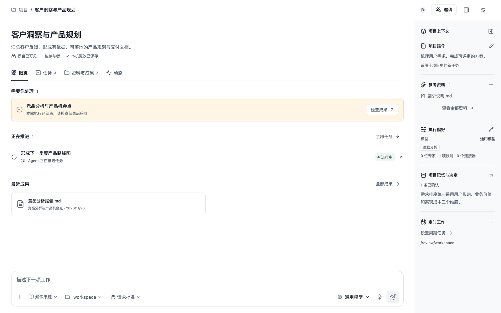
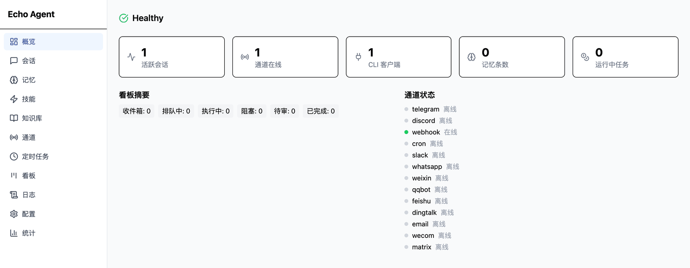

<div align="center">

<h1></h1>

**Echo Agent 是一个支持跨会话记忆的 AI 助手。你可以用它在桌面处理文档、代码和网页，在终端运行，或自托管接入微信、飞书和钉钉。**

<p>
  <a href="#desktop"></a>
  &nbsp;
  <a href="#runtime"></a>
</p>

[](https://pypi.org/project/echo-agent/)
[](https://github.com/fuyuxiang/echo-agent/actions/workflows/ci.yml)
[](LICENSE)
[](https://github.com/fuyuxiang/echo-agent/stargazers)

[文档](https://fuyuxiang.github.io/echo-agent/) · [架构](docs/concepts/architecture.md) · [版本记录](CHANGELOG.md) · [English](README.en.md)

</div>

## 快速开始

**Desktop** 是在电脑上使用 Echo Agent 的工作台。**Runtime** 可以直接在终端运行，也可以部署为服务，接入消息通道或供应用通过 API 调用。两种方式均可独立使用。

### Desktop

1. [下载安装包](https://github.com/fuyuxiang/echo-agent-desktop/releases)，支持 macOS（Apple Silicon、Intel）和 Windows x64。
2. 打开应用，在「设置 → 模型」添加并测试模型连接，或使用组织提供的模型。
3. 选择工作目录和权限模式，提交任务，在会话里查看执行进度和结果。[完成第一个任务](docs/desktop/quickstart.md)

[](docs/assets/readme/desktop-project.png)

*当前源码版的 Desktop 项目工作台，使用示例数据。* [从源码运行](docs/desktop/installation.md#从当前仓库源码运行)

### Runtime

在 Python 3.11+ 的虚拟环境中运行以下命令。在向导中配置 OpenAI 或兼容服务的模型与凭据。如果向导已启动 Gateway，跳过最后一条命令。[其他模型和平台](docs/getting-started/installation.md)

```bash
python -m pip install "echo-agent[openai]"
echo-agent setup --flow quickstart
echo-agent gateway
```

启动后，在 [Playground](http://127.0.0.1:58123/playground) 发送第一条消息，在 [Dashboard](http://127.0.0.1:58123/) 查看服务状态。也可以选择 `echo-agent run` 直接在终端使用。同一工作区只运行一个实例。

[Runtime 快速开始](docs/getting-started/quickstart.md) · [全屏终端界面预览](docs/assets/readme/runtime-tui.png)

[](docs/assets/readme/runtime-dashboard.png)

*Gateway Dashboard，使用示例数据。*

## 核心能力

- **跨会话记忆。** 新会话可召回相关的会话摘要、项目背景和用户偏好。[记忆系统](docs/concepts/memory-system.md)
- **桌面任务与审批。** 生成并预览 Word、Excel、PowerPoint 和 PDF，在授权目录修改代码，或操作浏览器和受支持的桌面应用。执行计划、工具调用和文件改动可在会话中查看，审批按所选权限模式处理。[代码任务](docs/desktop/coding.md) · [办公文档](client/docs/office-documents.md) · [平台与权限](docs/desktop/automation.md)
- **桌面项目与协作。** 项目保存指令、参考资料和已确认的决定，项目内的新任务可以沿用这些上下文，也可安排专家分工和定时任务。[项目协作与定时任务](docs/desktop/collaboration-scheduling.md) · [团队项目](client/docs/team-projects.md)
- **消息接入与自动化。** Runtime 的 14 个通道涵盖微信、飞书、钉钉、Slack、Webhook、定时任务和终端等入口。Gateway 提供 HTTP 和 WebSocket API。[消息通道](docs/integrations/channels/index.md) · [Gateway API](docs/reference/gateway-api.md)
- **技能进化。** Runtime 可从执行记录提出技能改动，在同一组用例上对照评估，支持人工审核和回滚。默认关闭。[技能进化与评估](docs/concepts/evolution-evaluation.md)
- **扩展。** Desktop 和 Runtime 均支持 MCP。Runtime 内置 35 个技能，支持插件，并可通过 A2A 接收其他 Agent 委派的任务。当前 Agent 运行时不提供 A2A 出站委派入口。[Skills、插件和 MCP](docs/runtime-extensions.md) · [A2A 集成](docs/integrations/a2a.md)

## 文档

- **Desktop** · [安装与源码构建](docs/desktop/installation.md) · [任务与权限](docs/desktop/tasks-permissions.md) · [数据管理](docs/desktop/operations.md)
- **Runtime** · [安装选项](docs/getting-started/installation.md) · [后台服务](docs/operations/background-service.md) · [安全模型](docs/concepts/security-model.md)
- **架构与开发** · [系统架构](docs/concepts/architecture.md) · [桌面端架构](docs/concepts/desktop-architecture.md) · [仓库地图](docs/development/repository-map.md)

## 参与贡献

[贡献指南](CONTRIBUTING.md) · [问题反馈](https://github.com/fuyuxiang/echo-agent/issues) · [社区讨论](https://github.com/fuyuxiang/echo-agent/discussions) · [QQ 群 47572014](https://qm.qq.com/q/JWOPDBNssw) · [安全报告](SECURITY.md)

## 许可证

项目原创代码采用 PolyForm Noncommercial License 1.0.0，超出许可范围的商业使用需另行授权。[许可证全文](LICENSE)

<details>
<summary>下载统计</summary>

<!-- Download badges are refreshed by .github/workflows/download-stats.yml. -->


[](https://github.com/fuyuxiang/echo-agent/actions/workflows/download-stats.yml)

</details>
