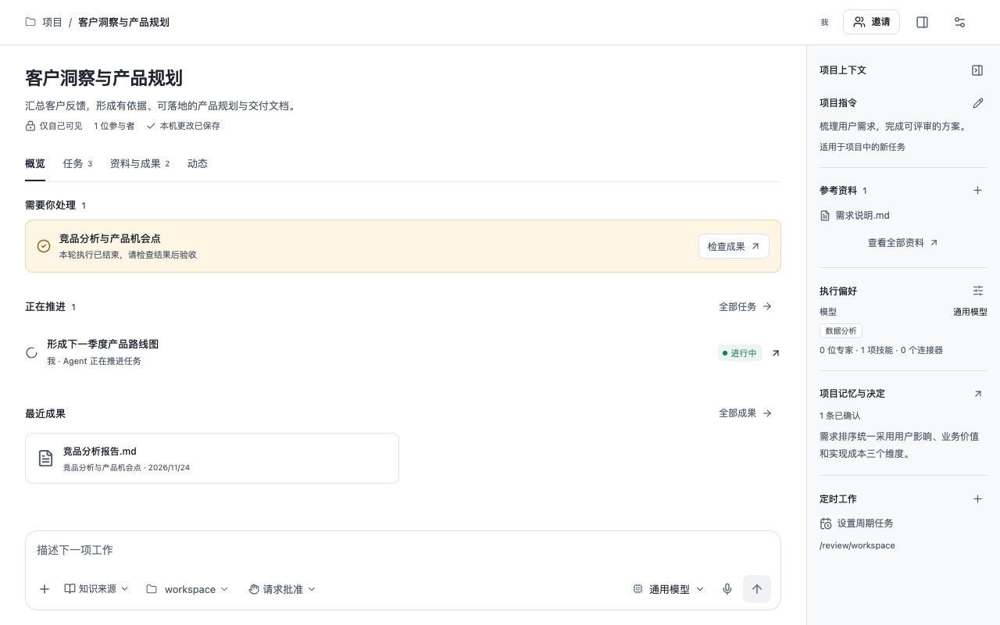

<div align="center">

<h1></h1>

**让 Agent 记住上下文，把经验转化为技能。**

在桌面处理项目，或自托管 Agent，运行定时任务并接入消息通道和 API。

<p>
  <a href="#运行自己的-agent"></a>
  &nbsp;
  <a href="#在桌面处理项目"></a>
</p>

[记忆与技能](#记忆与技能) · [架构](docs/concepts/architecture.md) · [文档](#文档) · [English](README.en.md)

[](https://pypi.org/project/echo-agent/)
[](https://pypi.org/project/echo-agent/)
[](https://github.com/fuyuxiang/echo-agent/actions/workflows/ci.yml)
[](https://fuyuxiang.github.io/echo-agent/)
[](LICENSE)
[](https://github.com/fuyuxiang/echo-agent/stargazers)

<!-- Download badges are refreshed by .github/workflows/download-stats.yml. -->


[](https://github.com/fuyuxiang/echo-agent/actions/workflows/download-stats.yml)

</div>

## 在桌面处理项目

做竞品分析时，可以把需求说明放进 EchoAgent Desktop 的项目，请 Agent 写一份报告。在「资料与成果」里打开报告核对内容，再点击「用于新任务」，把报告作为下一项任务的参考资料。项目里的新任务会沿用项目指令和已确认的决定。

[](client/docs/images/echoagent-project-workspace.png)

*EchoAgent Desktop 的项目概览，使用示例数据。*

下载与你的设备匹配的安装包，支持 **macOS（Apple Silicon、Intel）和 Windows x64**。在「设置 → 模型」添加并测试自己的模型连接，或使用组织提供的模型。选好工作目录和权限模式后即可发起任务。[下载桌面端](https://github.com/fuyuxiang/echo-agent-desktop/releases) · [完成第一个任务](docs/desktop/quickstart.md)

- 让 Agent 在授权的目录中修改代码，在会话中检查文件改动和验证结果。在办公任务中，可以生成并检查 Word、Excel、PowerPoint 或 PDF 文件。[代码任务与文件变更](docs/desktop/coding.md) · [办公文档](client/docs/office-documents.md)
- 让 Agent 操作网页或已授权的桌面应用，在任务中查看操作记录和权限请求。[平台支持与权限](docs/desktop/automation.md)
- 为任务选用专家、技能和 MCP 连接器，为项目安排定时任务。接入组织服务后，可以邀请成员协作。[定时任务](docs/desktop/collaboration-scheduling.md) · [团队项目](client/docs/team-projects.md)

## 运行自己的 Agent

在终端运行 Echo Agent Runtime，可以直接向 Agent 交代任务。部署为服务后，可以安排它每周整理一份报告，或让它响应消息通道、Webhook 和应用发来的请求。[消息通道](docs/integrations/channels/index.md) · [Gateway API](docs/reference/gateway-api.md)

在 **Python 3.11+** 的虚拟环境中安装，按向导配置模型。下面以 OpenAI 或兼容接口为例。[其他模型和平台的安装方式](docs/getting-started/installation.md)

```bash
python -m pip install "echo-agent[openai,tui]"
echo-agent setup --flow quickstart
```

配置完成后，用 `echo-agent run` 在终端发起任务，或用 `echo-agent gateway` 启动服务。Gateway 默认在 [Dashboard](http://127.0.0.1:58123/) 提供管理界面，在 [Playground](http://127.0.0.1:58123/playground) 提供对话入口。同一工作区选择一种启动方式。向导如果已启动 Gateway，可以直接打开网页，也可以用 `echo-agent cli` 连接它。[首次运行](docs/getting-started/quickstart.md) · [服务部署](echo-agent-runtime/README.md)

### 记忆与技能

- **跨会话记忆。** 新会话可以找回相关的会话摘要、项目背景和用户偏好。例如，下一次生成周报时，可以用上此前保存的报告格式。[记忆系统](docs/concepts/memory-system.md)
- **技能进化。** Runtime 可以从执行记录中提出技能改动，在同一组用例上比较改动前后的表现。你可以要求人工审核，也可以回滚已应用的改动。技能进化默认关闭。[技能进化与评估](docs/concepts/evolution-evaluation.md)

## 文档

桌面应用内置 Rust 执行引擎。独立的 Python Runtime 可以单独安装和部署，模型配置、会话和记忆由各端分别管理。[系统架构](docs/concepts/architecture.md)

- **桌面端** · [安装与源码构建](docs/desktop/installation.md) · [使用指南](client/README.md) · [数据管理](docs/desktop/operations.md)
- **Runtime** · [构建与部署](echo-agent-runtime/README.md) · [后台服务](docs/operations/background-service.md) · [Skills、插件和 MCP](docs/runtime-extensions.md) · [安全模型](docs/concepts/security-model.md)
- **集成与开发** · [API 参考](docs/reference/gateway-api.md) · [Python 组件装配](echo-agent-runtime/echo_agent/app.py) · [仓库地图](docs/development/repository-map.md)

[完整文档](https://fuyuxiang.github.io/echo-agent/) · [版本记录](CHANGELOG.md)

## 参与贡献

[贡献指南](CONTRIBUTING.md) · [问题反馈](https://github.com/fuyuxiang/echo-agent/issues) · [社区讨论](https://github.com/fuyuxiang/echo-agent/discussions) · [QQ 群 47572014](https://qm.qq.com/q/JWOPDBNssw) · [安全报告](SECURITY.md)

## 许可证

项目原创代码采用 PolyForm Noncommercial License 1.0.0。超出许可范围的商业使用需另行授权。[许可证全文](LICENSE)
