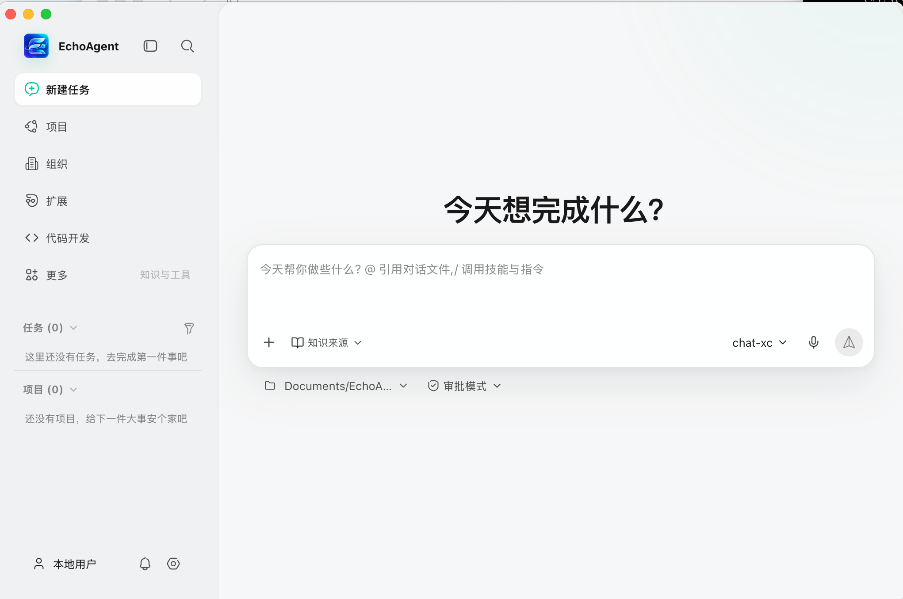

<div align="center">

<h1></h1>

**Echo Agent** 是一款支持长期记忆、专家协作和技能进化的 AI Agent。

可用于桌面办公、代码开发和远程自动化。<br />
项目背景和任务经验可在后续工作中复用，支持持续协作。

<p>
  <a href="#desktop"></a>
  &nbsp;
  <a href="#runtime"></a>
</p>

[](https://pypi.org/project/echo-agent/)
[](https://github.com/fuyuxiang/echo-agent/actions/workflows/ci.yml)
[](LICENSE)
[](https://github.com/fuyuxiang/echo-agent/stargazers)

<!-- Download badges are refreshed by .github/workflows/download-stats.yml. -->


[](https://github.com/fuyuxiang/echo-agent/actions/workflows/download-stats.yml)

[文档](https://fuyuxiang.github.io/echo-agent/) · [架构](docs/concepts/architecture.md) · [English](README.en.md)

</div>

## 快速开始

Desktop 可处理文档、代码和网页。Runtime 支持终端交互和服务部署。两者可独立使用。

### Desktop

1. [下载安装包](https://www.ojlab.com/download)。支持 macOS（Apple Silicon 和 Intel）及 Windows x64。
2. 打开客户端，在「设置 → 模型」中添加并测试模型连接。也可选用组织提供的模型。
3. 选择工作目录和权限模式，提交任务。执行进度和结果可在会话中查看。

[](client/docs/images/echoagent-home.png)

### Runtime

在 Python 3.11 或更高版本的虚拟环境中执行以下命令。按向导提示配置 OpenAI 或兼容服务的模型与凭据。

若向导已启动 Gateway，可跳过最后一条命令。

```bash
python -m pip install "echo-agent[openai]"
echo-agent setup --flow quickstart
echo-agent gateway
```

启动 Gateway 后，可在 [Playground](http://127.0.0.1:58123/playground) 发送消息，在 [Dashboard](http://127.0.0.1:58123/) 查看服务状态。

如需直接在终端交互，可运行 `echo-agent run`。同一工作区只运行一个完整 Runtime 实例。

## 主要功能

### 记忆与技能进化

新会话可检索相关会话摘要、项目背景和用户偏好。

[记忆系统](docs/concepts/memory-system.md)

Runtime 可根据任务执行记录提出技能改进方案，并用同一组用例对照评估。该功能默认关闭，启用后支持人工审核与回滚。

[技能进化与评估](docs/concepts/evolution-evaluation.md)

### 桌面任务与项目协作

Desktop 可生成和预览 Word、Excel、PowerPoint 及 PDF 文件，在授权目录中修改代码，也可操作浏览器和受支持的桌面应用。执行计划、工具调用和文件变更可在会话中查看。操作审批按所选权限模式处理。

[代码任务](docs/desktop/coding.md) · [办公文档](client/docs/office-documents.md) · [平台与权限](docs/desktop/automation.md)

项目保存指令、参考资料和已确认的决定，供项目内的新任务沿用。可在项目中安排专家分工和定时任务。

[项目协作与定时任务](docs/desktop/collaboration-scheduling.md) · [团队项目](client/docs/team-projects.md)

### 消息接入与扩展

Runtime 提供 14 个通道，涵盖微信、飞书、钉钉、Slack、终端、Webhook 和定时任务等入口。Gateway 提供 HTTP 和 WebSocket API，供其他应用调用。

[消息通道](docs/integrations/channels/index.md) · [Gateway API](docs/reference/gateway-api.md)

Desktop 和 Runtime 均支持 MCP。Runtime 内置 35 个技能，支持插件。现阶段，A2A 用于接收其他智能体委派的文本任务。当前 Agent 运行时不提供 A2A 出站委派入口。

[Runtime 扩展](docs/runtime-extensions.md) · [A2A 集成](docs/integrations/a2a.md)

## 文档

- **Desktop** · [安装与源码构建](docs/desktop/installation.md) · [任务与权限](docs/desktop/tasks-permissions.md) · [数据管理](docs/desktop/operations.md)
- **Runtime** · [安装选项](docs/getting-started/installation.md) · [后台服务](docs/operations/background-service.md) · [安全模型](docs/concepts/security-model.md)
- **架构与开发** · [系统架构](docs/concepts/architecture.md) · [桌面端架构](docs/concepts/desktop-architecture.md) · [仓库地图](docs/development/repository-map.md)

## 参与贡献

[贡献指南](CONTRIBUTING.md) · [问题反馈](https://github.com/fuyuxiang/echo-agent/issues) · [QQ社群](https://qm.qq.com/q/JWOPDBNssw)

## 许可证

项目原创代码采用 PolyForm Noncommercial License 1.0.0。超出许可范围的商业使用须另行取得授权。
