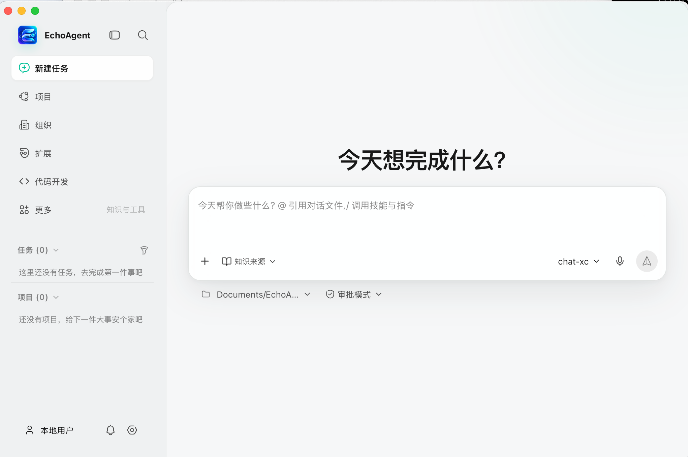
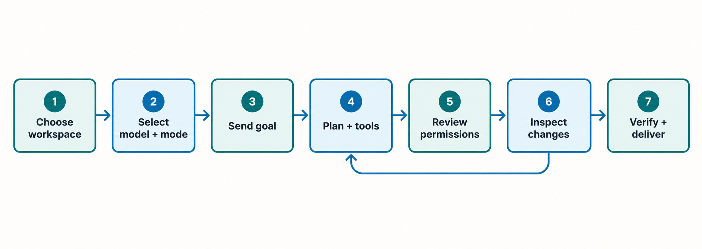
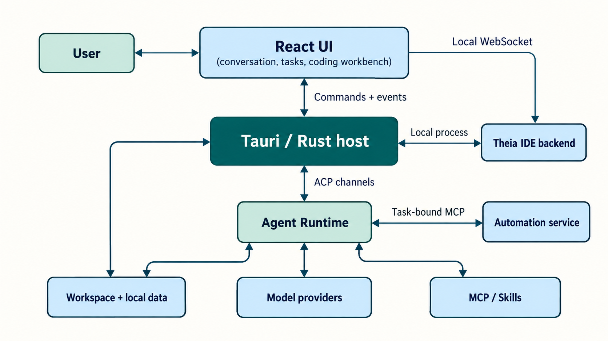

<p align="center"></p>

<h1 align="center">EchoAgent</h1>

<p align="center"><strong>Let AI finish work in a real workspace, with every step visible and under your control.</strong><br />A source-available, local-first desktop agent workspace for conversations, tool use, coding, and reviewable delivery.</p>

<p align="center"><a href="README.md">简体中文</a> · <a href="#quick-start">Quick start</a> · <a href="#capabilities">Capabilities</a> · <a href="#architecture-and-data-flow">Architecture</a> · <a href="#contributing">Contribute</a> · <a href="https://github.com/fuyuxiang/echo-agent-desktop/issues">Issues</a></p>

<p align="center"><a href="https://github.com/fuyuxiang/echo-agent-desktop/actions/workflows/ci.yml"></a> <a href="LICENSE"></a>  </p>

<p align="center"></p>

EchoAgent binds each conversation to a real working directory. Choose a model and permission mode, describe a goal, then inspect plans, tool calls, file changes, and results in one desktop app. Most application state stays on your computer; model inference and optional external services still require network access.

## Capabilities

| Area | Current implementation |
| --- | --- |
| **Expert groups** | Reuse local experts and saved group templates; address members with @mentions, discuss with read-only tools, delegate work, collect results, review approvals, and retain decisions and deliverables. |
| **Agent tasks** | Streaming conversations, plans and tasks, tool calls, approvals, session history, rewind and fork, and subagent status. |
| **Coding** | Embedded Eclipse Theia IDE with an editor, file tree, search, terminal, Git, and previews; Echo Code manages task stages, diff review, verification, and delivery. |
| **Browser and desktop control** | Browser Use has a separate profile for each task and confirms operations with side effects separately. Computer Use supports native macOS AX / Windows UIA controls with screenshot fallback, starts from an explicit desktop task, and runs continuously with pause controls. Availability is detected on the current device; see the documented real-device verification status. |
| **Models and extensions** | Built-in remote models and custom model connections; MCP, Skills, Plugins, connectors, and reusable experts. |
| **Knowledge and documents** | Local knowledge index, project context, memory, common-file reading, and local generation of Word, PDF, Excel, and PowerPoint files. |
| **Ongoing work** | Projects and work items, scheduled automations, notifications, meeting recordings and minutes, plus optional WeChat remote sessions and organization services. |

Read more: [Echo Code](docs/echo-code-theia.md) · [Browser Use / Computer Use](docs/automation-platform-support.md) · [Native desktop controls and validation](docs/desktop-control/README.md) · [Office documents](docs/office-documents.md) · [Live information](docs/live-information.md) · [WeChat remote sessions](docs/weixin-remote.md) · [Skill capability declarations](docs/skill-capability-manifest.md)

## Quick start

### Install the desktop app

Check [GitHub Releases](https://github.com/fuyuxiang/echo-agent-desktop/releases) for an installer matching your operating system and processor. Desktop release targets are **Windows x86_64**, **macOS Apple Silicon**, and **macOS Intel**. If no suitable installer is available, run from source as described below. There is currently no official Linux desktop package.

### Run from source

You need Node.js **22.23.4+ (22.x) or 24.22.1+ (24.x)**, pnpm **10**, npm **11.21.1+** (for the embedded IDE toolchain), Rust **1.96.0+** (stable), the Protocol Buffers compiler `protoc`, and your platform's native build tools. macOS requires Xcode Command Line Tools. Windows requires the Visual Studio 2022 C++ build tools and Windows SDK. The embedded Agent Runtime source is committed in this repository; no submodule initialization is needed.

**macOS**

```bash
git clone https://github.com/fuyuxiang/echo-agent-desktop.git
cd echo-agent-desktop
pnpm setup:mac
pnpm install --frozen-lockfile
pnpm tauri dev
```

**Windows (PowerShell)**

```powershell
git clone https://github.com/fuyuxiang/echo-agent-desktop.git
cd echo-agent-desktop
pnpm setup:win
pnpm install --frozen-lockfile
.\dev.bat
```

The first launch builds and stages the embedded Theia IDE, Office Worker, and Rust Runtime, so it can take longer than later builds. `pnpm tauri dev` starts the full desktop app; `pnpm dev` starts only the Vite frontend.

### Start your first task

1. Select a working directory, model, and permission mode on the home screen.
2. Describe your goal and send it. For file tasks, select the directory you intend to authorize.
3. Follow the plan and tool activity, handle approval requests when they appear, and inspect diffs and verification results for file changes.

Before using the app, add and test a personal connection and model under **Settings → Models**. Custom connections support OpenAI, Anthropic, and compatible APIs. Tool use and other model features depend on the service. Personal model configuration is stored locally in `~/.echo-agent/config.toml`.

Built-in chat models are no longer provided. Upgrades remove their catalog and saved selections while preserving conversations, files, personal connections, and organization models. Scheduled tasks bound to a retired model are paused and marked as needing a model selection. Edit the task to choose an available model or explicitly follow the default, save, then enable it again; upgrades never silently switch these tasks to another service. Knowledge and memory retrieval services are unchanged.

<p align="center"></p>

<p align="center"><sub>This shows a typical file-editing task. Skip approval or change-review stages when they do not apply.</sub></p>

### Control your desktop through chat

Describe the target app, action, and expected result directly. On macOS, for example: “Use the desktop to open TextEdit, create a plain-text document containing ‘Meeting notes’, and save it to the Desktop as ‘Meeting notes.txt’.” On Windows, specify Notepad. An explicit desktop request automatically selects Computer Use; you can also select it from the tools menu. Discussion, code review, and file-generation requests do not start desktop control merely because they mention an app.

- Execution continues within the task without per-step approval. Send “停一下” or `/pause` to pause; send “continue saving” or `/resume` in the same chat to continue. The paused task also offers a “继续任务” (Continue task) button.
- Add a save location, filename, or other requirement in the same chat. After an application restart, the task stays paused until you explicitly continue.
- Check the actual saved path and file content. Clicking Save or receiving a successful tool response does not prove the file was saved correctly.

On first use, macOS requires Accessibility and Screen Recording permission for the app you actually run. Windows requires an accessible interactive desktop. Locked screens, system security interfaces, passwords, and protected controls may require manual intervention. See [native desktop controls and validation](docs/desktop-control/README.md) for supported conditions and verification results.

## Architecture and data flow

React 18 renders the interface. Tauri 2 and Rust manage native capabilities, state, and processes. The Agent Runtime runs **in process** and communicates with the host over typed ACP channels. The host starts the Echo Code Theia backend as a local process. The Runtime accesses browser and computer automation through a local, task-bound MCP service.

<p align="center"></p>

| Directory | Responsibility |
| --- | --- |
| [`src/`](src/) | React UI, state management, and frontend domain logic. |
| [`src-tauri/src/`](src-tauri/src/) | Tauri commands, ACP bridge, policy, storage, coding workbench, and automation backend. |
| [`vendor/echo-agent-build/`](vendor/echo-agent-build/) | Pinned embedded Agent Runtime source snapshot. |
| [`vendor/theia-platform/`](vendor/theia-platform/) | Eclipse Theia source and IDE integration. |
| [`scripts/`](scripts/) · [`docs/`](docs/) | Build, verification, release scripts, and detailed documentation. |

### Memory

Manage the memory switch and records under **Settings → Memory**. Completed tasks can extract reusable preferences, work context, project facts, and recent follow-ups; pending extraction is retained for retry. Global preferences work across projects, while project facts stay scoped to their workspace. You can add, correct, forget, inspect sources, import text or JSON with a preview, and copy an export. Manually saved records are protected from automatic rewriting.

Corrections and forgetting exclude superseded facts and associated sources from subsequent use. Inactive records remain available for inspection, and original chats remain in history. Turning memory off stops its use and automatic extraction in subsequent requests while keeping existing records manageable.

### Expert groups

Create an expert group from the sidebar's experts area or from a session team. Choose 1–8 local experts, a model, and a workspace; a coordinator joins automatically. Groups have their own chat, work records, decisions, and deliverables. Address a member with `@member name`, use `@全体` for everyone, or reply to a member. Read-only discussion restricts tools in the Runtime; execution uses each member's own Runtime session.

Save reusable member, role, and model settings as templates without copying chat history. Model-proposed decisions require confirmation and retain revision history. Follow-ups can supplement the ongoing request; pausing stops further dispatch, while stopping cancels active work and pending summaries. Work interrupted by a restart requires review before retrying. Member memory is scoped to the group, member, and workspace; clearing it preserves chats and confirmed group decisions.

### Data and permission boundaries

- The default data root is `~/.echo-agent/`. Set `ECHO_AGENT_HOME` before launch to change it. Model configuration lives in `config.toml`, MCP configuration in `mcp.json`, and sessions and workbench state in subdirectories under that root.
- Provider API keys are stored in a local configuration file. Protect it and do not commit it or attach it to a public issue. Personal model connections require HTTPS by default; HTTP requires explicit consent.
- “Local-first” does not mean offline. Task content sent to a model, as well as webpage content or screenshots provided through Browser Use or Computer Use, reaches the selected model service. MCP, notifications, cloud storage, and optional organization features may also access external services.
- Workspace authorization, permission modes, and action confirmations govern Agent activity. Browser Use restricts private-network access by default. Computer Use starts from an explicit user task and executes continuously without per-step approval. Pausing, stopping, switching modes, or restarting revokes the old execution lease; operating-system permissions remain required. Desktop task scope is execution context, not an OS filesystem sandbox. Theia's interactive terminal runs as the current OS user; review commands from unfamiliar projects.

See the [automation platform and security guide](docs/automation-platform-support.md) for platform requirements and operation boundaries.

## Development

| Command | Purpose |
| --- | --- |
| `pnpm tauri dev` | Start the full desktop app, preparing Theia and the Office Worker automatically. |
| `pnpm test` | Run frontend Vitest tests. |
| `pnpm test:scripts` | Verify browser labels, test signing, IDE state and process cleanup, log redaction, native review guards, desktop task evidence, pagination, timing, and tool inputs; also run in CI. |
| `pnpm test:ide` | After building Theia, verify pinned VSIX integrity and SCM command completion and failure propagation. |
| `pnpm test:security` | After installing Theia dependencies, verify archive path protection, SCANOSS output, compatibility patches, and runtime version requirements. |
| `pnpm security:audit` | Use Python 3.11+ and network access to audit frontend, IDE, and all Rust lockfiles, retaining raw reports; also run in CI. |
| `pnpm test:native-guards` | On macOS, run synthetic native review report, isolation, and continuation regressions without starting the desktop app; this does not qualify real UI behavior. |
| `pnpm test:desktop-native` | Compile production native desktop modules independently and run regressions without starting the full Runtime or dispatching desktop input; macOS event-object tests require an accessible graphical session. |
| `pnpm test:task-recovery` | Verify webpage input and task recovery UI in real Chromium; requires Playwright and Chromium, configurable with `PLAYWRIGHT_MODULE` and `CHROME_BIN`. |
| `pnpm test:mermaid` | Verify actual diagram rendering, wrapping, preview, copy, download and failure recovery; also test native WKWebView on macOS. |
| `pnpm test:ui:contrast` | Check text, controls and status icons across themes, window sizes and font sizes, including overlays, plan approval, dirty-file counts, recording animation and edited fields. Unreadable reference cases verify the detector itself. |
| `pnpm test:ui:contrast:complex` / `pnpm test:ui:contrast:webkit` | Sample actual pixels behind text on gradients, illustrations and select controls, or verify native macOS WKWebView forms and theme changes. |
| `pnpm build` | Type-check TypeScript and build the production frontend. |
| `pnpm test:production-startup` | After building, serve production assets and check startup, script errors, and resource loading in an isolated browser; CI retains screenshots and reports. |
| `pnpm office:test` | Verify the built-in document generator. |
| `pnpm test:rust` | Run all Rust unit and integration tests with isolated data; locally sign this workspace's test harnesses on macOS before execution. |
| `pnpm test:memory:rust` | Run the memory dependency's complete unit suite with isolated data, including source logs, forgetting, archives and title corrections; locally sign its own harness on macOS. Runs in CI. |
| `cargo fmt --manifest-path src-tauri/Cargo.toml --check` | Check Rust formatting. |
| `cargo clippy --locked --manifest-path src-tauri/Cargo.toml --lib -- -D warnings` | Run Rust static analysis. |
| `pnpm dist:mac` / `pnpm dist:win` | Build an installer on the corresponding platform; production releases require platform signing. |

CI runs Rust formatting independently so formatting errors do not prevent static analysis and functional test results. Before committing, run `cargo fmt --manifest-path src-tauri/Cargo.toml` to format the code, then run the formatting check, Clippy and `pnpm test:rust` listed above.

See the [desktop release guide](docs/desktop-release.en.md) for packaging.

See [dependency security maintenance](docs/dependency-security.md) for dependency upgrades, compatibility patches, and lockfile updates.

Native acceptance runners, starting with `scripts/validate-native-review.mjs`, use a built desktop executable and isolated temporary data. Model-based flows require an explicit private test connection supplied through `NATIVE_REVIEW_MODEL_CONFIG`; they are not started by ordinary unit tests. For macOS desktop tasks, use [`scripts/validate-native-desktop-controls.mjs`](scripts/validate-native-desktop-controls.mjs) with `--smoke`, `--journey`, `--task-flow`, or `--universal-flow`. Completion requires real Runtime logs, independent file verification, and UI evidence. Unit tests or Windows cross-compilation do not replace real-device acceptance. See [desktop validation records](docs/desktop-control/validation.md) for preparation, verification entry points, and the scope of historical runs.

Diagram checks reuse Theia's optional Playwright installation, or accept `PLAYWRIGHT_MODULE` pointing to an independently installed Playwright `index.mjs`. Browser tools are used only for development checks. The checks use an ephemeral local port and the production SVG image to verify text and node bounds, long circular labels, explicit line breaks, multiline Markdown, tree connections, configuration isolation between diagram kinds, preview, source, copy, download, and failure recovery. Set `CHROME_BIN` to select Chromium and `UI_REVIEW_OUTPUT` to choose the screenshot and geometry directory. Native WKWebView checks on macOS require Xcode Command Line Tools and cover the same label boundaries and configuration isolation. CI runs these checks on Windows, macOS, and Linux.

## Contributing

Contributions to issues, docs, tests, and code are welcome. Create a branch from `main`, run checks relevant to your change, and describe the change, risks, and verification in your pull request. Open an [issue](https://github.com/fuyuxiang/echo-agent-desktop/issues) to discuss larger features or architectural changes.

## FAQ

<details>
<summary>Can I use a local model?</summary>

Yes. Add a local service with an OpenAI- or Anthropic-compatible API as a custom connection. HTTP connections must be explicitly allowed under the app's connection policy. Tool use and multimodal support depend on the specific model.

</details>

<details>
<summary>Do I need an EchoAgent account for personal use?</summary>

No. Configure your own personal model connection. Organization services are optional.

</details>

<details>
<summary>Is Linux supported?</summary>

The automation backend has some Linux platform support, but there is currently no official Linux desktop installer. See the [automation platform guide](docs/automation-platform-support.md) for its conditions.

</details>

## License and acknowledgements

Original project code is available under the [PolyForm Noncommercial License 1.0.0](LICENSE) for the purposes permitted by that license. Commercial uses outside those purposes require separate permission from the maintainers.

Third-party components retain their respective licenses. This update does not revoke rights already granted under earlier licenses.

Earlier MIT notice: [LICENSES/MIT.txt](LICENSES/MIT.txt). The embedded Runtime, Theia, and other third-party components retain their own licenses; see [Third-Party Notices](THIRD_PARTY_NOTICES.md). Built with [Tauri](https://tauri.app/), [React](https://react.dev/), and [Eclipse Theia](https://theia-ide.org/).

### Local retrieval models

Personal knowledge and local memory use bundled, pinned ONNX INT8 versions of `BAAI/bge-base-zh-v1.5` (768 dimensions) and `BAAI/bge-reranker-base` (about 400MB installed). The app reads its resources directly: first use requires no model download or copy and local retrieval works offline. Model maintenance in Knowledge or Memory settings supports verification, repair and offline import. A failed maintenance action reports its error separately while preserving healthy active models. Wide spreadsheets retain non-empty values with cell coordinates, and presentation citations follow the actual slide order. Only missing or damaged files may require downloads; repairs use the user data directory and never modify signed app resources. Keyword retrieval remains available if models or CPU support are unavailable. Automatic memory recall skips reranking and caps semantic waiting at 650ms. Organization knowledge retains its server-side scopes, authorization, citations and model pipeline. Retrieved evidence provenance survives conversation persistence and compaction, preventing automatic conversion into unrestricted personal memory.

Embeddings and reranking run locally. Evidence used to answer and content used for memory extraction still reach the selected chat model. Fixed model versions, offline paths and checksums are in `vendor/echo-agent-build/crates/codegen/echo-agent-memory/src/model-assets.json`.

Tauri development and packaging run `pnpm retrieval:prepare`, staging verified files in the Git-ignored `src-tauri/resources/retrieval-models/` directory. For offline builds, use `pnpm retrieval:prepare --source /path/to/models` or set `ECHO_RETRIEVAL_MODELS_SOURCE`. `pnpm retrieval:check` validates all SHA256 checksums; release compilation also rejects incomplete or corrupt model resources. Model and inference-runtime license notices are included in the installer.

With verified model files available, `pnpm test:retrieval-offline` uses separate fresh profiles to test bundled first use without copying weights and offline package import into user data, including real embeddings, reranking and file verification.
