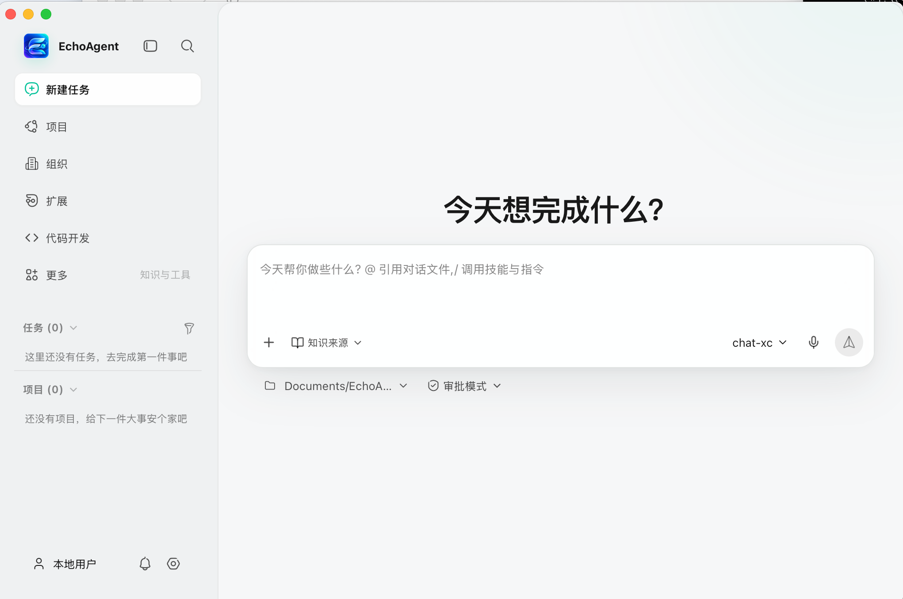
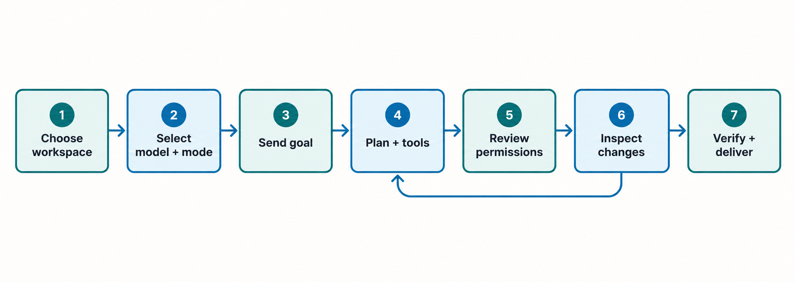
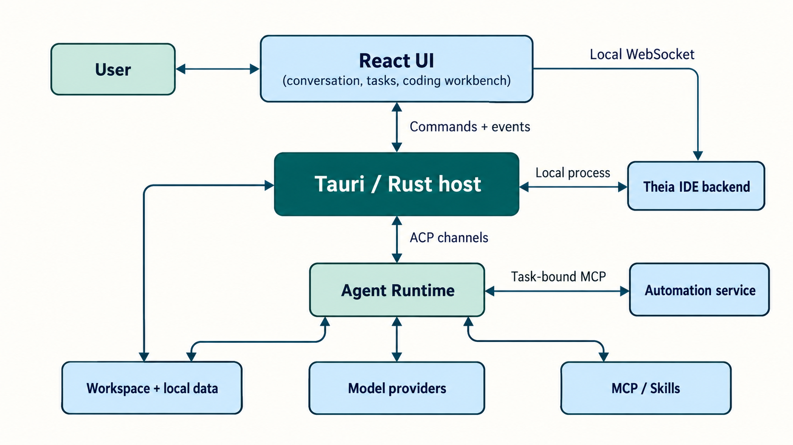

<p align="center"></p>

<h1 align="center">EchoAgent</h1>

<p align="center"><strong>让 AI 在真实工作区中完成任务，并让每一步都可查看、可控制。</strong><br />开源、本地优先的桌面 Agent 工作台，集成对话、工具执行、代码开发与任务交付。</p>

<p align="center"><a href="README.en.md">English</a> · <a href="#快速开始">快速开始</a> · <a href="#主要能力">主要能力</a> · <a href="#架构与数据流">架构</a> · <a href="#参与贡献">参与贡献</a> · <a href="https://github.com/fuyuxiang/echo-agent-desktop/issues">反馈问题</a></p>

<p align="center"><a href="https://github.com/fuyuxiang/echo-agent-desktop/actions/workflows/ci.yml"></a> <a href="LICENSE"></a>  </p>

<p align="center"></p>

EchoAgent 将会话绑定到实际工作目录。你可以选择模型和权限模式，提出目标，随后在同一桌面应用中查看 Agent 的计划、工具调用、文件变更和结果。应用状态主要保存在本机；模型推理及按需启用的外部服务仍需要网络连接。

## 主要能力

| 场景 | 当前实现 |
| --- | --- |
| **专家团** | 复用本地专家与已有专家团；支持中文 @成员、只读讨论、协作派发、成员结果汇总、权限审批、决定记录与交付物。 |
| **Agent 任务** | 流式对话、计划与任务、工具调用、权限审批、会话历史、回溯与分叉、子 Agent 状态。 |
| **代码开发** | 内嵌 Eclipse Theia IDE，提供编辑器、文件树、搜索、终端、Git 和预览；Echo Code 管理任务阶段、Diff 审阅、验证与交付。 |
| **浏览器与桌面操作** | Browser Use 使用任务独立的浏览器资料，有副作用的操作单独确认；Computer Use 支持 macOS AX / Windows UIA 原生控件与截图坐标后备，从明确的电脑任务启动，连续执行并可随时暂停。能力由当前设备实时检测，实机验证状态见文档。 |
| **模型与扩展** | 内置远端模型和自定义模型连接；支持 MCP、Skills、Plugins、连接器与专家。 |
| **知识与办公** | 本地知识索引、项目上下文、记忆；在任务中读取常见文件，并在本机生成 Word、PDF、Excel 和 PowerPoint。 |
| **持续工作** | 项目与工作项、定时任务、通知、会议录音与纪要，以及可选的微信远程会话和组织服务。 |

进一步了解：[Echo Code](docs/echo-code-theia.md) · [Browser Use / Computer Use](docs/automation-platform-support.md) · [原生桌面控件与验收](docs/desktop-control/README.md) · [办公文档](docs/office-documents.md) · [实时信息](docs/live-information.md) · [微信远程会话](docs/weixin-remote.md) · [Skill 能力声明](docs/skill-capability-manifest.md)

## 快速开始

### 安装桌面应用

从项目的 [GitHub Releases](https://github.com/fuyuxiang/echo-agent-desktop/releases) 获取与你的系统和处理器架构匹配的安装包。桌面发行目标为 **Windows x86_64**、**macOS Apple Silicon** 和 **macOS Intel**。发行页没有适用安装包时，可按下文从源码运行。Linux 目前没有正式桌面发行包。

### 从源码运行

构建需要 Node.js **22.23.4+（22.x）或 24.22.1+（24.x）**、pnpm **10**、npm **11.21.1+**（内置 IDE 工具链）、Rust **1.96.0+**（stable）、Protocol Buffers 编译器 `protoc`，以及对应平台的原生工具链。macOS 需要 Xcode Command Line Tools；Windows 需要 Visual Studio 2022 C++ 构建工具和 Windows SDK。完整的内嵌 Agent Runtime 源码已经随仓库提交，无需初始化 submodule。

**macOS**

```bash
git clone https://github.com/fuyuxiang/echo-agent-desktop.git
cd echo-agent-desktop
pnpm setup:mac
pnpm install --frozen-lockfile
pnpm tauri dev
```

**Windows（PowerShell）**

```powershell
git clone https://github.com/fuyuxiang/echo-agent-desktop.git
cd echo-agent-desktop
pnpm setup:win
pnpm install --frozen-lockfile
.\dev.bat
```

首次启动会构建并暂存内嵌 Theia IDE、Office Worker 和 Rust Runtime，可能需要较长时间。`pnpm tauri dev` 运行完整桌面应用；`pnpm dev` 只启动 Vite 前端。

### 创建第一个任务

1. 在首页选择工作目录、模型和权限模式。
2. 输入目标并发送；如果任务要读写文件，请选择实际要授权的目录。
3. 查看计划与工具执行过程，按需处理权限请求；有文件修改时检查 Diff 和验证结果。

应用提供内置模型，**无需填写个人 API Key，但推理会访问项目配置的远端服务**。若要使用自己的模型，在「设置 → 模型」中添加连接、模型并测试。自定义连接支持 OpenAI、Anthropic 及其兼容接口；模型的工具调用等能力取决于实际服务。个人模型配置保存在本机 `~/.echo-agent/config.toml`。

<p align="center"></p>

<p align="center"><sub>图示为涉及文件修改的典型路径；没有权限请求或文件变更时，可跳过相应步骤。</sub></p>

### 用自然语言操作电脑

直接在聊天中说明目标应用、操作和结果。例如在 macOS 发送：“请在 TextEdit 新建纯文本文稿，写入‘会议记录’，保存到桌面的‘会议记录.txt’。”Windows 可指定记事本。明确的电脑操作请求会自动接入 Computer Use；也可从工具菜单手动选择。普通讨论、代码评审和文件生成请求不会仅因提到应用名称而启动桌面操作。

- 任务内连续执行，无需逐步确认。发送“停一下”或 `/pause` 可暂停；在同一聊天发送“继续保存”或 `/resume` 可续做，暂停时也可点击“继续任务”。
- 保存位置、文件名等要求可继续在同一聊天补充。应用重启后任务以暂停状态保留，需要主动继续。
- 完成后核对实际保存路径和文件内容；点击保存或工具返回成功不等于文件已经正确保存。

macOS 首次使用需在系统设置中为实际运行的应用授予“辅助功能”和“屏幕录制”权限。Windows 需要可访问的交互桌面；锁屏、系统安全界面、密码和受保护控件可能需要用户接管。支持范围和验证结果见 [原生桌面控件与验收](docs/desktop-control/README.md)。

## 架构与数据流

EchoAgent 使用 React 18 构建界面，Tauri 2 与 Rust 负责桌面能力、状态和进程管理。Agent Runtime 作为**进程内组件**运行，通过类型化 ACP Channel 与宿主通信。Echo Code 的 Theia 后端由宿主启动为本机进程；浏览器和电脑操作通过绑定当前任务的本地 MCP 服务交给 Runtime 使用。

<p align="center"></p>

| 目录 | 职责 |
| --- | --- |
| [`src/`](src/) | React 界面、状态管理与前端领域逻辑。 |
| [`src-tauri/src/`](src-tauri/src/) | Tauri 命令、ACP 桥接、策略、存储、代码工作台和自动化后端。 |
| [`vendor/echo-agent-build/`](vendor/echo-agent-build/) | 锁定的内嵌 Agent Runtime 源码快照。 |
| [`vendor/theia-platform/`](vendor/theia-platform/) | Eclipse Theia 源码及 IDE 集成。 |
| [`scripts/`](scripts/) · [`docs/`](docs/) | 构建、验证、发行脚本与专题文档。 |

插件可启用／禁用，按来源卸载受管理的安装包或移除用户配置路径。卸载前会列出同一安装包内受影响的插件，外部来源可打开目录管理。操作失败保留错误信息以便重试。

### 菜单栏与系统托盘

macOS 菜单栏和 Windows 托盘使用相同的任务菜单：最多显示三个入口，优先展示待确认、运行中和最近访问的任务；专家团按一个入口展示，内部成员与子任务不重复计数，已归档和隐藏任务不进入菜单。空闲时显示“最近任务”，首次使用没有记录时直接提供“新对话”“打开 EchoAgent”和“退出 EchoAgent”。“查看全部任务…”打开跨工作区搜索，也可查找专家团名称。

macOS 使用单色品牌标识，点击展开菜单；Windows 使用透明背景品牌图标，左键或双击恢复窗口，右键展开菜单。菜单打开期间保持条目稳定。点击任务恢复原会话与工作区，待确认任务定位到授权、提问或计划确认区域；窗口恢复和页面重新加载期间的点击会保留到界面能够处理。关闭窗口后的行为由“关闭窗口后继续运行”控制，有任务运行或等待确认时，退出应用前会提示中断影响。

退出保护独立读取后端实际执行与待确认状态，已归档、隐藏或专家团内部的会话仍受保护；界面恢复期间也不依赖菜单计数。状态读取失败或超时时，可选择继续运行或确认退出。异步打开专家团期间切换到其他任务或页面，以最后一次导航为准；后台审批初始化与实时事件合并同步。

### 记忆

“设置 → 记忆”集中管理总开关与记忆内容。任务完成后自动提取有依据的个人偏好、工作背景、项目事实和近期事项；提取失败或快速退出时保留待处理内容，重新打开工作区后重试。全局偏好跨项目使用，项目事实按工作区隔离；短期事项可标记完成或设置有效期。历史问题可由助手查找原对话，并读取来源消息核实。

支持添加、更正、遗忘、来源查看，以及粘贴其他 AI 的文本或 JSON 预览导入、复制导出。手动保存的内容不会被自动整理覆盖；更正和遗忘会排除旧事实及关联来源的再次使用。遗忘条目保留在“已停用”供检查，原聊天仍可在历史记录中查看。关闭总开关立即停止后续请求中的记忆使用和自动提取，已有内容仍可管理。排查状态与旧版文档按需展开，旧版关闭的独立策略保留并提供显式恢复入口。

### 专家团

从侧栏“专家·技能·连接器”的“专家团”页签创建和管理专家团，或从会话的“团队”选择“以此团队创建专家团”。会话团队只管理当前会话的成员分工；专家团有独立的聊天、工作与决定记录。已经关联专家团的团队会显示“打开专家团”，归档后也打开原记录，不重复创建。已创建的专家团仍可从侧栏列表直接进入。选择 1–8 名本地专家、模型和工作区，协调员会自动加入。普通消息交给协调员；输入 `@成员名`、`@全体`，或回复某位成员，可直接确定收件人。只读讨论在 Runtime 中限制工具权限，适合先讨论目标和风险。

“专家团模板”管理页与创建页只展示通过“保存为模板”明确保存的成员、分工和模型，不自动收录会话团队，也不包含聊天记录。同名保存会更新模板，已建立的专家团保留自己的配置。模板支持刷新与删除；缺少专家或模型时会提示调整。创建时切回“自行选择专家”会清空模板带入的配置；刷新发现模板被删除时保留当前填写内容。删除会话会同步清理所属团队登记；升级启动时修复来源会话已不存在的历史登记，保留仍有会话存储的团队、个人专家和已保存模板。

侧栏“群聊”列表位于“项目”下方，与“任务”“项目”使用统一标题样式，可独立滚动、折叠和查看全部群聊。管理页卡片、侧栏条目和聊天顶部共用操作菜单，可重命名、置顶、保存模板、归档／恢复和永久删除。归档提供撤销；删除正在工作的专家团会先确认停止，清理失败保留记录并允许重试。永久删除会按归属记录清理内部执行历史（包括摘要损坏的记录）、关联记录、专家团成员记忆和本机草稿；本机存储失败可重试，重启后继续清理，个人专家、已保存模板与工作区文件保留。列表分批展示，轻量目录索引覆盖全部专家团，刷新列表不加载专家定义和决定修订史。回复时会明确显示实际收件人，可交给协调员汇总并保留引用。

专家团内“成员 / 工作 / 交付物 / 设置”集中展示分工、实际执行状态、工具生成的文件、模型与工作区。可保存专家团模板、增减成员、刷新专家定义，并把消息记为专家团决定；模型提出的决定需要用户确认；决定可更正、作废和恢复，保留修改记录，作废内容不再作为后续工作依据；有效决定超过本轮上下文容量时会提示合并或作废过时决定，全部原记录保留。发送失败保留草稿，相同待发送消息重试使用同一个请求 ID。暂停只停止后续派发，准备中的工作保留在队列；停止会同时取消运行中的工作和待汇总工作。协调员派发后即使遇到模型异常，也会在成员结果到齐后继续汇总，避免重做已经完成的工作。重启中断的工作标为“需要检查”，检查已有结果后手动重试。

执行仍由当前内嵌 Agent Runtime 完成。每位成员拥有独立的原生执行会话和只读讨论会话；宿主的 `groups` 模块负责持久化消息、排队、依赖与结果回传，不另建推理内核。成员通过会话身份绑定的本地 MCP 工具派发工作，结果到齐后恢复请求方。默认每个专家团最多同时运行两名成员，同一工作区的执行工作串行；每次请求限制自动调用次数、派发深度和成员重复调用。Token 预算按原生回合结束后的实际用量校验，达到预算后停止后续自动派发。

专家发言保持完整，工具活动收在同一次发言中，默认折叠，可展开并在右侧查看详情。运行状态来自实际工作记录；原生思考事件不进入群聊，文本中的推理标签在写入公共历史、工作结果和其他成员上下文前过滤，代码示例中的标签保留。升级时在事务中清理旧的模型公共输出，保留用户原文、已确认决定及修订历史，并保存私有迁移前快照供恢复，不重放模型调用。

同一收件人、同一知识来源且只有一个进行中请求时，继续发送会作为该请求的补充或纠正，界面标明对应的原请求。回复优先接续被引用的请求，不会串入该成员另一项进行中的任务；直接向执行中的子专家补充也会接续其原任务。定向补充送给指定成员；交给请求负责人的纠正也会送至其正在执行的协作成员，后续交付会带上补充内容；原生回合已消费的补充不会重复触发续跑，错过回合的补充由持久化工作接续。多个请求难以确定归属时保留明确的收件人路由。发送“停止当前任务”“停止任务”或“取消任务”优先停止被回复的任务，否则仅在全群有唯一进行中的请求时执行；无法确定目标会提示回复指定任务。“停止”“stop”“停止全部”会停止整个专家团。部分取消失败会继续尝试其他成员，并允许再次停止。失败重试保留原请求及补充中的附件、知识摘录和引用。模型提出新决定仍须确认；用户明确更正或撤回已确认决定时，成员可引用本次用户消息及原文依据更新决定，修改记录保留。

专家团存于数据根目录的 `collaboration.sqlite`，使用 SQLite 事务和 WAL；专家配置按专家团快照，记忆按专家团、成员和工作范围隔离。成员模型按“本群覆盖 → 本地专家指定 → 创建时执行模型”确定，保存实际生效的模型；刷新专家定义保留本群模型选择。更换模型或刷新定义会建立新上下文并保留当前成员记忆，更换工作区会隔离到新记忆代次。已有旧代次不会自动合并，避免混入其他工作区信息。

可直接请成员记住、更正或忘记明确的信息，原生 `memory_manage` 会更新记忆及召回排除规则；群历史和工作结果的召回也遵守同一规则；历史按当前成员水位及分页范围读取，每次读取使用一份最新规则快照，避免长历史逐条重复读取记忆文件。成员页“管理成员”支持清除某位成员的长期记忆并重建上下文，清除后停止自动召回其清除前的群聊；用户仍可主动引用历史，已确认的群决定与其他成员的独立记忆保留。当前会话、共享决定、成员记忆是不同来源，清除成员记忆不会删除聊天记录。来源私聊只有勾选引用后才共享；个人和组织知识由专家团自己的知识来源选择控制。专家团数据库、成员记忆、草稿和待发送消息均随应用数据备份，恢复不会自动重放中断的执行。

### 数据与权限边界

- 默认数据根目录是 `~/.echo-agent/`，可在启动前通过 `ECHO_AGENT_HOME` 调整。模型配置位于 `config.toml`，MCP 配置位于 `mcp.json`，会话与工作台状态存放在该根目录下的对应子目录。
- Provider API Key 保存在本机配置文件中。请保护该文件，避免将其提交到仓库或附在公开 Issue 中。个人模型连接默认要求 HTTPS；内置模型使用项目配置的远端 HTTP 服务。
- “本地优先”不等于离线。发送给模型的任务内容，以及启用 Browser Use / Computer Use 后提供的网页内容或屏幕截图，会到达所选模型服务；MCP、通知、云存储和可选组织能力也可能访问外部服务。
- 工作区授权、权限模式与操作确认共同控制 Agent 行为。Browser Use 默认限制私网访问；Computer Use 从明确的用户任务启动，任务内连续操作，不逐步弹窗。暂停、停止、切换模式和重启撤销旧执行令牌；系统权限仍按操作系统要求授予。电脑任务范围是执行上下文，不是操作系统文件沙箱。Theia 的交互终端以当前系统用户身份运行，应审查来源未知项目中的命令。

详细的平台条件与操作边界见 [自动化安全说明](docs/automation-platform-support.md)。

## 开发

| 命令 | 用途 |
| --- | --- |
| `pnpm tauri dev` | 启动完整桌面应用，并自动准备 Theia 与 Office Worker。 |
| `pnpm test` | 运行前端和 `scripts/**/*.test.mjs` 两个 Vitest 项目。 |
| `pnpm test:coverage` | 执行全部 ui project 测试，采集前端生产 TS/TSX 的 V8 覆盖率，包含未导入模块；scripts project 仍由 `pnpm test` 执行。报告位于 `coverage/`。 |
| `pnpm test:scripts` | 验证浏览器快照标签、测试签名范围、IDE 状态与进程回收、日志脱敏、原生验收条件，以及桌面任务证据、分页、计时和工具入参；CI 自动运行。 |
| `pnpm test:ide` | 构建 Theia 后验证固定 VSIX 完整性和 SCM 命令完成、失败传播。 |
| `pnpm test:security` | 安装 Theia 依赖后验证压缩包路径保护、SCANOSS 报告输出、兼容补丁和运行时版本门槛。 |
| `pnpm security:audit` | 使用 Python 3.11+ 联网审计前端、IDE 与全部 Rust 锁文件，保留原始报告；CI 自动运行。 |
| `pnpm test:native-guards` | 在 macOS 运行原生验收工具的合成报告、隔离和续跑条件回归；不启动桌面应用，也不代表真实界面验收。 |
| `pnpm test:desktop-native` | 独立编译生产原生桌面模块并运行回归，不启动完整 Runtime 或派发桌面输入；macOS 事件对象测试需要可访问的图形会话。 |
| `pnpm test:task-recovery` | 在真实 Chromium 中验证网页输入和任务恢复界面；需可用的 Playwright 与 Chromium，可用 `PLAYWRIGHT_MODULE`、`CHROME_BIN` 指定。 |
| `pnpm test:mermaid` | 验证真实图表渲染、换行、预览、复制、下载及失败恢复；macOS 同时检查原生 WKWebView。 |
| `pnpm build` | TypeScript 类型检查与前端生产构建。 |
| `pnpm test:production-startup` | 构建后用静态服务和隔离浏览器检查真实生产资源启动、脚本错误及资源加载；日常 CI 自动运行并保留截图、报告。 |
| `pnpm office:test` | 验证内置文档生成器。 |
| `pnpm test:rust` | 在新临时数据目录运行全部 Rust 单元与集成测试；macOS 先对本仓库的测试程序作本地 ad hoc 签名，避免大型未签名测试程序的子进程启动延迟。 |
| `pnpm test:runtime-smoke` | 显式运行两个 ignored 的真实 Runtime/MCP/Skills 验收；使用全新隔离数据和合成模型配置，不发送模型请求。 |
| `cargo fmt --manifest-path src-tauri/Cargo.toml --check` | 检查 Rust 格式。 |
| `cargo clippy --locked --manifest-path src-tauri/Cargo.toml --lib -- -D warnings` | 运行 Rust 静态检查。 |
| `pnpm dist:mac` / `pnpm dist:win` | 在对应平台构建发行安装包；正式发行需平台签名。 |

CI 的原生 Runtime 验收分别运行在 Windows x64、macOS Intel（`macos-15-intel`）和 macOS Apple Silicon（`macos-15`）。每个平台执行隔离的全部 Rust 单元与集成测试，以及不调用模型的 Runtime/MCP/常驻技能刷新验收；macOS 测试程序使用本地 ad hoc 签名。恢复稳定性测试同样覆盖这三个客户端。原生作业会校验宿主架构，避免以交叉编译检查替代实际运行。

CI 的 Rust 格式检查独立运行，格式错误不会阻止静态检查与功能测试提供结果。提交前可运行 `cargo fmt --manifest-path src-tauri/Cargo.toml` 修正格式，再执行上表中的格式检查、Clippy 和 `pnpm test:rust`。

发行步骤见 [桌面发行说明](docs/desktop-release.md)。

依赖升级、兼容补丁来源和锁文件更新步骤见 [依赖安全维护](docs/dependency-security.md)。

原生验收入口为 `scripts/validate-native-review.mjs`，以及 `validate-native-browser-review.mjs`、`validate-native-core-review.mjs`、`validate-native-ide-git-review.mjs`、`validate-native-local-review.mjs`、`validate-native-webdav-review.mjs` 和 `validate-native-exit-recovery-review.mjs`。这些工具需要已构建的桌面可执行文件，使用独立临时数据目录；主验收流程包含首次启动和重启检查。涉及模型的流程需要可用的项目内置模型服务，定时任务验收会等待真实到点。它们不会由普通单元测试自动启动。

macOS 原生桌面任务使用 [`scripts/validate-native-desktop-controls.mjs`](scripts/validate-native-desktop-controls.mjs)，支持 `--smoke`、`--journey`、`--task-flow` 和 `--universal-flow`。桌面任务是否完成需结合真实 Runtime 日志、独立文件核验和界面证据判定；单元测试或 Windows 交叉编译通过不能替代实机验收。准备步骤、核验入口和历史实测范围见 [桌面验收记录](docs/desktop-control/validation.md)。

新增原生验收工具默认将报告写入系统临时目录；可通过各入口的 `NATIVE_*_REVIEW_OUTPUT` 环境变量指定保留位置，通用桌面和会议界面验收使用 `UI_REVIEW_OUTPUT`。Code 验收中的续跑选项必须显式指定原输出目录，保留原始报告与独立临时数据目录。WebDAV 验收需在独立 Python 环境安装 `WsgiDAV` 和 `cheroot`，再用 `WEBDAV_REVIEW_PYTHON` 指定该环境的 Python；可选 `WEBDAV_REVIEW_PYTHONPATH` 用于显式依赖目录。Office 内容独立核验脚本 `validate-native-office-content.py` 另需 `python-docx`、`openpyxl`、`python-pptx` 和 `pypdf`。报告、截图、安装包和用户运行数据不属于项目源码。

图表验收复用 Theia 的可选 Playwright 安装，也可通过 `PLAYWRIGHT_MODULE` 指向独立安装的 Playwright `index.mjs`。浏览器工具仅用于开发验证。验收使用随机本地端口和实际生产 SVG 图片，检查文字与节点边界、长圆形标签、显式换行、Markdown 多行、树连接、图表类型切换后的配置隔离，以及预览、源码、复制、下载和失败恢复。可用 `CHROME_BIN` 指定 Chromium 可执行文件、`UI_REVIEW_OUTPUT` 指定截图与几何数据目录；macOS 需要 Xcode Command Line Tools，原生 WKWebView 也会检查这些标签边界及配置隔离。CI 在 Windows、macOS 和 Linux 上运行该检查。

## 参与贡献

欢迎提交问题、文档、测试和代码改进：从 `main` 创建分支，运行相关检查，并在 Pull Request 中说明改动、风险与验证结果。较大的功能或架构调整可先开 [Issue](https://github.com/fuyuxiang/echo-agent-desktop/issues) 讨论。

## 常见问题

<details>
<summary>可以使用本地模型吗？</summary>

可以。添加提供 OpenAI 或 Anthropic 兼容接口的本地服务作为自定义连接。HTTP 连接需按应用的连接策略显式允许；工具调用和多模态能力由具体模型决定。

</details>

<details>
<summary>个人使用需要 EchoAgent 账户吗？</summary>

不需要。可使用内置模型或自行配置模型连接；组织服务是可选功能。

</details>

<details>
<summary>支持 Linux 吗？</summary>

Linux 自动化后端已有部分平台适配，但项目目前没有正式 Linux 桌面安装包。平台条件见 [自动化安全说明](docs/automation-platform-support.md)。

</details>

## 许可证与致谢

EchoAgent 应用代码采用 [MIT License](LICENSE)。内嵌 Runtime、Theia 和其他第三方组件遵循各自许可证，详见 [Third-Party Notices](THIRD_PARTY_NOTICES.md)。项目基于 [Tauri](https://tauri.app/)、[React](https://react.dev/) 和 [Eclipse Theia](https://theia-ide.org/) 构建。
