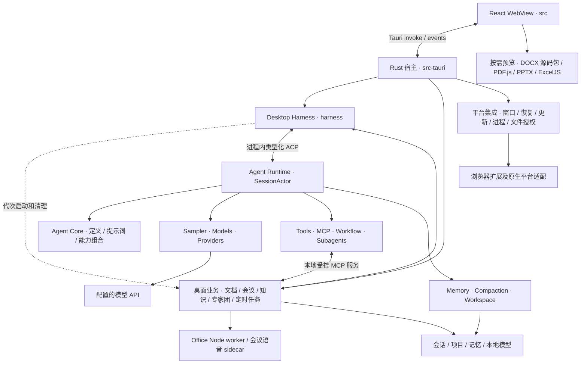
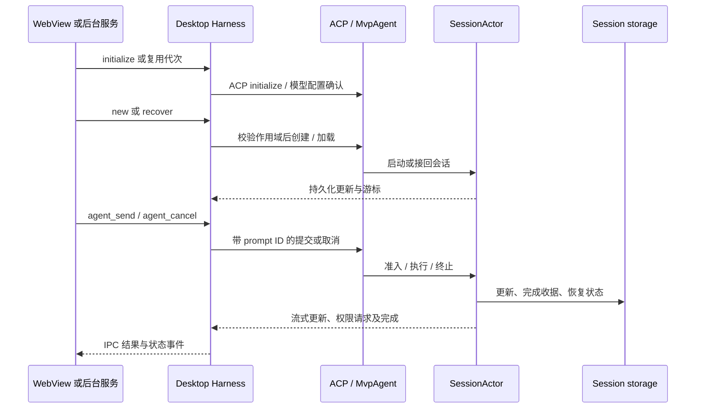

# EchoAgent Desktop 架构与维护边界

桌面应用由 React 18、TypeScript、Zustand、Vite 和 Tauri 2 构成。Rust 宿主内嵌一个 Agent Runtime，使用类型化 ACP channel 与其通信。WebView 调用 Tauri IPC，桌面服务也可在宿主内发起任务。Office 导出和会议转写有独立的子进程。知识检索与记忆可共享本机推理资源，各自拥有业务数据和检索策略。



## 启动、执行与恢复

1. [`main.rs`](../src-tauri/src/main.rs) 进入 [`lib.rs`](../src-tauri/src/lib.rs) 的宿主启动程序。宿主选择数据目录和 WebView 配置，安装日志、进程监督和单实例保护，恢复备份与录音，注册应用状态和命令。团队、Office、组织和自动化等本机 MCP 服务在可用时先完成注册。WebView 由 [`main.tsx`](../src/main.tsx) 挂载，启动逻辑在 [`App.tsx`](../src/App.tsx) 调用 `agentInit`。定时任务和微信接入也可以经宿主启动 Runtime。
2. [`harness/commands.rs`](../src-tauri/src/harness/commands.rs) 序列化初始化、处理既有运行代次并对齐已被 Runtime 确认的模型配置。 [`harness/agent_runtime.rs`](../src-tauri/src/harness/agent_runtime.rs) 装配桌面配置、BYOK 客户端和本地记忆检索，启动专用 OS 线程、current-thread Tokio `LocalSet` 和 `MvpAgent`。ACP dispatcher 与 Runtime 各持 channel 一端。一个应用进程可承载多个会话 Actor。
3. [`agent-client.ts`](../src/lib/agent-client.ts) 发起创建、读取、发送和取消。Harness 校验已授权的工作区、模型、策略与附件，绑定作用域并为创建、提交或取消建立相应的标识。创建超时的并发请求通过 [`session_creation.rs`](../src-tauri/src/harness/session_creation.rs) 和 [`state.rs`](../src-tauri/src/harness/state.rs) 跟踪，重试可接回迟到的结果。执行交给 [`echo-agent-runtime`](../agent/crates/echo-agent-runtime)，由它构建上下文、管理对话 Actor、采样、分发工具与子 Agent、协调压缩及记忆。
4. [`harness/bridge.rs`](../src-tauri/src/harness/bridge.rs) 分发更新和完成事件，协调权限、提问、计划审批与目录信任的回执，将 ACP 数据转换为现有 `agent://*` 事件。前端的 [`session-store.ts`](../src/stores/session-store.ts) 和相关 hooks 更新任务及记录的投影。请求的 ACP 准入、信号撤回与终止语义在 Runtime 的 `session/helpers/host_prompt_admission.rs`、SessionActor 和 sampler 流处理内实现。
5. Runtime 的 `session/persistence.rs` 和 `session/storage/` 持久化会话与更新游标。宿主的 [`meta.rs`](../src-tauri/src/meta.rs)、[`sessions.rs`](../src-tauri/src/sessions.rs) 使用会话索引、桌面状态与作用域恢复本地视图。WebView 重建可以接回复用的 Runtime 代次。完整退出等待 Actor 持久化并监督子进程。失败重启可重放已保存的更新，自动化按自己的恢复记录处理未完成运行。复用历史会话时沿用原工作区、工作权限和旧格式读取路径。



## Agent 源码与职责

| 位置 | 职责 |
| --- | --- |
| [`src-tauri/src/harness/`](../src-tauri/src/harness/) | 桌面运行控制。`commands` 负责产品请求协调和 IPC 适配，`state` 负责代次、会话绑定和已确认的模型快照，`agent_runtime` 装配运行实例并发起 ACP 调用，`bridge` 管理事件与交互回执。`agent_config`、`permission_config`、`policy`、`skills` 和 `team_orchestration` 负责相关桌面策略、技能目录接入和团队请求解析。 |
| [`agent/crates/echo-agent-runtime/`](../agent/crates/echo-agent-runtime/) | `MvpAgent`、SessionActor、上下文构建、会话队列、工具调度、ACP 生命周期、取消、持久化和恢复。`runtime-base`、`runtime-session-support`、`runtime-terminal` 分别承担 Runtime 共用机制、会话辅助能力和终端适配。 |
| [`echo-agent-core`](../agent/crates/echo-agent-core/)、[`echo-agent-tools`](../agent/crates/echo-agent-tools/) | Core 维护 Agent 定义、构建、提示词、插件发现与工具编排入口。Tools 以及 `tool-types`、`tool-protocol`、`tool-runtime` 分别维护实现、参数类型、传输契约与工具执行的共用机制。Skills 的内容装载由 Core 和 Tools 消费。 |
| [`echo-agent-sampler`](../agent/crates/echo-agent-sampler/)、[`echo-agent-models`](../agent/crates/echo-agent-models/) | 模型目录、Chat Completions / Responses / Messages 的请求、持续流、终止和失败转换。桌面提供确认后的模型选择、连接和权限。 |
| [`echo-agent-memory`](../agent/crates/echo-agent-memory/)、[`echo-agent-compaction`](../agent/crates/echo-agent-compaction/) | 记忆持久化、提取、检索、嵌入与重排。压缩在独立 crate 中对上下文执行维护，`compaction-transcript` 保存压缩边界与会话投影所需记录。 |
| [`echo-agent-workflow`](../agent/crates/echo-agent-workflow/)、[`echo-agent-subagent-resolution`](../agent/crates/echo-agent-subagent-resolution/)、[`echo-agent-mcp`](../agent/crates/echo-agent-mcp/) | 流程引擎、校验与日志，子 Agent 解析，以及外部工具协议连接。Runtime 的 `session/workflow` 和 `session` 串联这些能力。 |
| [`echo-agent-workspace`](../agent/crates/echo-agent-workspace/)、[`echo-agent-sandbox`](../agent/crates/echo-agent-sandbox/) | 工作区文件与进程、检查点、工作树，以及执行隔离。Desktop feature 约束专用于终端产品的 SCM、编辑器和工作树入口。 |
| [`agent/terminal/`](../agent/terminal/) | 终端客户端、渲染组件、独立 PTY CLI 和 PTY 测试。与 `agent/crates/` 共享 Agent workspace 锁文件。 |

桌面业务通过现有 Harness/ACP 入口发起运行，按业务拥有领域状态与任务记录。 [`groups/`](../src-tauri/src/groups/) 和 [`team_mcp.rs`](../src-tauri/src/team_mcp.rs) 管理专家团和会话团队模型，避免把成员路由及业务状态写进 Runtime。 [`automations.rs`](../src-tauri/src/automations.rs) 管理定时投递和运行收据， [`automation/`](../src-tauri/src/automation/) 管理任务范围内的桌面与浏览器操作和授权。组织同步、项目、个人知识、办公和会议分别由 `org*`、`projects.rs`、`personal_knowledge.rs`、`document_*` / `office_mcp.rs` 和 `meeting_*` 维护。呈现层按现有模块演进，`src/features/groups/` 已有独立状态和客户端，其他产品入口目前分布在 `src/components/`、`src/lib/`、`src/stores/`。

本次对照 `cargo metadata` 与桌面 `Cargo.lock`，Agent workspace 的 94 个成员中有 72 个出现在桌面锁图。锁图之外的成员包括终端程序、Ratatui 组件、终端独立更新与语音功能、Markdown/Mermaid 渲染及独立测试支撑。桌面生产路径按 `echo-agent-runtime` 的 `desktop` feature、目标平台和宿主启用的依赖特性解析。判断某个成员能否删除时，还应核对 Agent workspace 独立入口和各目标的条件编译。

[`message-queue-store.ts`](../src/stores/message-queue-store.ts) 管理前端待发送内容和确认状态，运行准入由 Runtime 决定。IPC 收到真实准入回执后更新 [`session-store.ts`](../src/stores/session-store.ts)。队列线类型由 [`echo-agent-prompt-queue`](../agent/crates/echo-agent-prompt-queue/) 维护，Runtime 的 `session/prompt_queue.rs` 保留现有调用入口并拥有 ACP 方法名。 [`legacy_workspace.rs`](../src-tauri/src/legacy_workspace.rs) 仍参与历史任务的数据读取与目录保护，继续按 [桌面恢复契约](desktop-recovery.md) 维护。

## 重构前后与源码依据

| 重构前 | 当前归属 | 源码依据与影响 |
| --- | --- | --- |
| `vendor/echo-agent-build/` | `agent/` | Desktop Cargo 原本直接引用 Runtime、Core、ACP、Memory 等本地 crate。启动过程没有单独下载或执行 Agent 二进制。将拥有这些源码的桌面仓库作为维护入口，保留独立 workspace、来源、许可和导入说明。 |
| `crates/codegen/`、`crates/common/`、`crates/build/`、`prod/mc/` | `agent/crates/<crate>`、`agent/terminal/<crate>` | Cargo 的 `[workspace]` 和相对 `path` 才定义依赖。旧目录同时包含生成过程、普通库和终端客户端。现在以 crate 名定位库，终端程序单独归位。Protobuf 构建仍使用 `echo-agent-proto-build`，共享配置仍消费 `echo-agent-chat-proxy-types`。 |
| 扁平 `src-tauri/src/{commands,agent_runtime,bridge,agent_config,…}.rs` | `src-tauri/src/harness/` | 初始化代次、会话绑定和模型快照原定义在 IPC 命令文件。抽取 `HarnessState` 后，由桥接和业务服务直接引用宿主持有状态；桌面模型默认值解析放回 `agent_config`，Runtime 装配可直接调用。Tauri 命令名、事件载荷、持久化字段和兼容 ID 沿用原合同。 |
| `vendor/echo-agent-build/third_party/` 与 `vendor/` 其他 Rust 源码 | `third-party/rust/` | 本地 fork 和 backport 由实际 Cargo `path` / `[patch.crates-io]` 选择。Agent 图形渲染的四个依赖保留 workspace membership、许可证和原始修改说明。 |
| `vendor/nodejs/` | `LICENSES/nodejs/` | `stage-office-node.mjs` 读取当前 Node 可执行文件并选择许可证。该目录内容为四个版本的许可证，Node 二进制仍在构建时按平台装入资源。 |
| `patches/` 和 Vite `.mjs` 别名 | `third-party/docx-preview/` | 官方 DOCX 0.9.0 发布包完整性及补丁前像与原锁一致。其源码 workspace 直接构建，延迟导入和 API 契约保持兼容。分页、分节及字体修正进入 TypeScript，许可证与依赖随安装包分发。 |

```text
重构前                              当前
src/                                src/
src-tauri/src/{commands,bridge,…}   src-tauri/src/harness/{commands,bridge,state,…}
src-tauri/{build.rs,resources,…}     src-tauri/{build.rs,resources,…}
vendor/echo-agent-build/             agent/
  crates/{codegen,common,build}/      crates/<crate>/
  prod/mc/                             crates/echo-agent-chat-proxy-types/
  crates/codegen/*pager*               terminal/
  third_party/                         ../third-party/rust/agent-rendering/
vendor/<第三方 Rust 组件>/           third-party/rust/<组件>/
vendor/nodejs/                       LICENSES/nodejs/
patches/                             third-party/docx-preview/{src,LICENSE,NOTICE,…}
.github/, scripts/, deploy/          .github/, scripts/, deploy/
public/, browser-extension/         public/, browser-extension/
docs/, LICENSES/                    docs/, LICENSES/
```

`src-tauri/` 保留 Tauri 约定的入口、配置、平台资源和原生测试。`public/` 保存随 Vite 打包的应用图标以及构建时写入的预览资源。`browser-extension/` 提供受控浏览器扩展。`scripts/` 维护开发、资源校验、隔离测试、包构建和发布。`deploy/update-server/` 提供更新清单及安装包发布服务。`.github/` 维护测试、安装验证和工作流语法检查。根目录的 pnpm、TypeScript、Vite、Rust 工具链和 Git 配置定义共享工程约定。

```text
src/
  main.tsx, App.tsx                   WebView 挂载、全局路由和启动
  components/, features/            产品界面与已聚合的功能模块
  lib/, stores/, types/              IPC 客户端、领域模型、状态投影与类型
  foundation/, styles/, assets/       设计组件、样式和界面资源
  experimental/                     独立实验组件
src-tauri/
  src/harness/                       桌面 Runtime 控制与 ACP 桥接
  src/{automation,groups}/            桌面操作与专家团业务服务
  src/                               其他业务、窗口和平台集成
  tests/, icons/, windows/            原生验证、图标与安装模板
  resources/, meeting-speech/         安装资源和独立会议语音 workspace
agent/
  crates/, terminal/, bin/            Agent 库、终端目标和工具链描述
  Cargo.toml, Cargo.lock              Agent workspace 与依赖解析
  SOURCE.json, MAINTENANCE.md          来源和本地维护记录
third-party/
  rust/, docx-preview/                 本地依赖源码与各自许可
scripts/
  lib/, fixtures/                     验证共用代码和测试夹具
  *-check/                            可隔离编译的宿主功能验证 crate
```

## 第三方源码、包和资源

| 组件 | 实际用途与处理 |
| --- | --- |
| `async-openai` 0.33.1、`nucleo` 0.5.0 | 分别支持采样 SDK 适配和模糊匹配。保留锁定的上游提交和本地源码。替换时须验证工具调用、流终止与 matcher 行为，避免恢复浮动 Git 依赖。 |
| `auto-launch` 0.5.0、`tauri-plugin-updater` 2.9.0 | 登录启动原生命令参数修正，以及带私有 CA 的更新和 Windows 安装交接。保留源代码和现有回归边界。可替换条件是上游验证支持相同的引用转义、TLS 与失败后的会话收尾行为。 |
| `cpal-loopback` 0.18.2 | 会议录音的系统音频捕获。保留 macOS 双工设备选路修正及 Windows 构建源。替换时实测会议录音的麦克风与系统声轨。 |
| `glib` 0.18.5、`lru` 0.12.5 / 0.16.4 | 保留 GTK3 ABI 的输出指针 backport，以及两个依赖版本各自的 LRU 内存安全 backport。宿主、Agent 和 fuzz 均用自己的 Cargo manifest 选择补丁。 |
| `faster-hex` 0.10.1、`ort-sys` 2.0.0-rc.10 | 前者移除未使用的易受影响的 `heapless` 特性依赖。后者保持 ONNX Runtime 1.22 的 ABI、归档校验和共享库落盘兼容。保留各自的 `SOURCE.json`、摘要和平台测试。 |
| `agent-rendering/{mermaid-to-svg,dagre_rust,graphlib_rust,ordered_hashmap}` | Rust 端 Mermaid 排版与 SVG 渲染，供 Agent workspace 的文档与终端能力使用。保留源码和通知。WebView 的 `mermaid` 由 pnpm 锁定，用于独立的 WebView 渲染。 |
| `@apollo-design/docx-preview` 0.9.0 | [`third-party/docx-preview`](../third-party/docx-preview/) 包含上游完整核心 TypeScript 源码、Apache 许可和发布版声明，保留 JSZip 与 Noble 包管理。在本地 workspace 源码中维护分页、分节及 iframe 字体加载。 |
| 公开包与构建工具 | React、Zustand、Tauri、Tokio、Serde、SQLite、Office JS 库、PDF.js 及测试工具继续按锁文件管理。Cargo registry 来源、npm overrides 和 Node 引擎要求保持显式。 |
| 随包资源 | Node 可执行文件、ripgrep、ONNX Runtime、本地检索和会议模型、会议 sidecar 和 PDF.js 资源分别由版本或 SHA-256 清单、锁文件和打包脚本管理，原始许可随包分发。安装、更新和离线修复路径看对应资源专题。 |

仓库原有 `SOURCE_REV` 作为导入附带的记录保留，桌面导入来源以 [`agent/SOURCE.json`](../agent/SOURCE.json) 的 `sourceRevision` 为准。各 Rust fork 的选择依据和验证路径见 [依赖维护](dependency-security.md) 与 [第三方通知](../THIRD_PARTY_NOTICES.md)。Cargo patch 仍用于兼容回移的解析入口，补丁本身维护在可构建源码中。DOCX 源码融合完成后，项目的 pnpm 产物补丁及 `patches/` 已移除。

## 开发与演进约定

- 用户界面、在途状态投影和文档预览属于 `src/`。持久化、审批和权限以宿主与 Runtime 校验为准。
- Runtime 生命周期、ACP 桌面适配及请求策略进入 Harness。多轮执行、工具调用、模型流、上下文和会话持久化进入现有 Agent crate。平台窗口、进程、业务存储和本机 MCP 服务留在宿主。Agent crate 依赖中不引入桌面宿主。
- 可从现有业务服务复用的授权、恢复和存储逻辑保持单一入口。开启新能力前先确定其数据所有者、失败恢复和从桌面到 Runtime 的调用契约。
- 通用依赖使用包管理。需要本地源码时记录发布版本或提交、完整性、许可、修改原因、源码入口和测试。变更路径时检查所有 workspace、构建脚本、审计清单、发布资源和 CI 触发范围。
- 运行 `node scripts/verify-agent-source.mjs` 核对来源元数据、源码结构与 Cargo Git 依赖。执行 [开发与验收](testing.md) 中对应检查，打包和签名以 [桌面发行](desktop-release.md) 和各目标平台的 CI 为准。

## 后续审查重点

宿主的 `harness/commands.rs`、`harness/bridge.rs` 和 `automations.rs` 还集中处理多类路径。当前 `agent_init` 启动调度器，`HarnessState` 在作废运行代次时触发自动化会话和宿主能力清理。这些回调与业务服务形成宿主内部的双向调用。进一步拆分应沿会话准入、交互回执、调度恢复分别做行为等价验证。终端、可选 feature 和工具仍由 Agent workspace 与各平台 Cargo 锁文件覆盖。只有证明跨 feature、构建脚本和独立测试都不依赖某个模块时，才删除它。Windows 安装交接、GLib 的 Linux GTK3 ABI、Apple Silicon 录音以及安装包签名需在对应平台验收。
