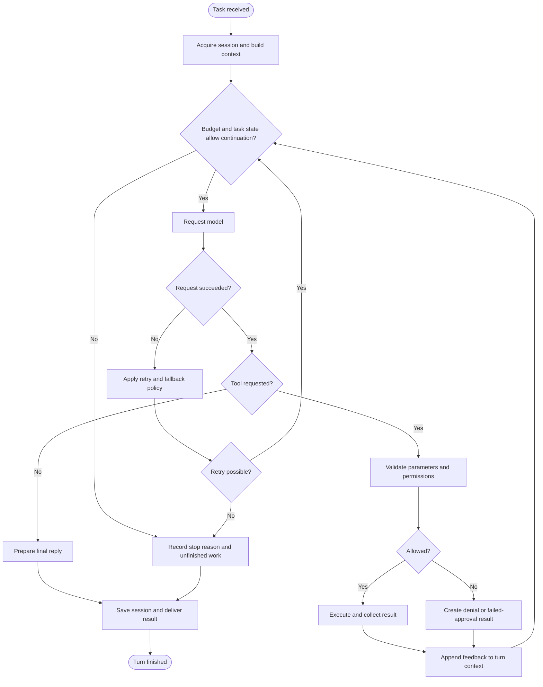

# Agent loop

An Agent loop turns a natural-language goal into observable operations: build context, request a model decision, validate and execute tools, and feed results back until completion or a limit. Models propose actions; the execution layer controls what actually runs.

Both products use this method. The stages below describe standalone Runtime. See [Desktop architecture](desktop-architecture.md) for host coordination.

## Three stages

| Stage | Work | Output |
| --- | --- | --- |
| Context | Resolve session and identity, read active history, recall eligible memory, retrieve knowledge, load skills | Budgeted model input |
| Reasoning and action | Select models, process text and tools, enforce policy and approvals, collect results | Text, operation evidence, execution state |
| Finalization | Prepare the reply, save history, schedule eligible consolidation and trace work | Deliverable results and persistent records |

Context contains selected material. Compression and output preservation manage input size without enlarging the model window.

## Tool feedback cycle

Rectangles are processing, diamonds are decisions, and rounded endpoints are terminals. Approval waiting is included in permission checks. Both acceptance and denial provide feedback for the next decision.

## Concurrency and ordering

Requests in the same session are serialized to protect active history. Ordinary messages queue; explicit cancellation uses control handling.

Tool calls are not unconditionally parallel. Only explicitly read-only, resource-compatible operations can use configured concurrency. Other operations run sequentially. Worker delegation has separate depth and concurrency limits.

## Termination and errors

Completion, cancellation, iteration limits, budgets, timeouts, or unrecoverable errors can end execution. Reaching a limit does not establish completion; retain the reason and unfinished work.

Model failures can use retries or configured fallbacks. Retrieval and reranking can degrade. Repeated tool failures encounter retry and circuit-breaker controls. Reduced capability must not be reported as verified success.

## Completion versus delivery

Streaming text is generation progress, a tool receipt describes an operation, and the final reply explains the turn. Generation, operation success, and delivery success are distinct. Verify actual files and platform send receipts. See [Events and delivery](events-delivery.md).
