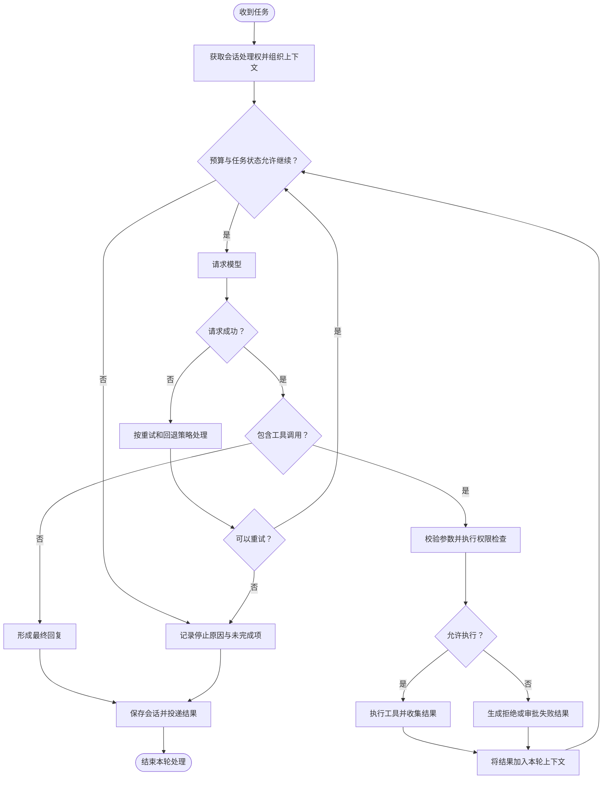

# Agent 循环

Agent 循环将自然语言目标转为一系列可观察的操作：组织上下文、请求模型决策、校验并执行工具、把结果送回模型，直到完成、失败或达到限制。模型提供建议，执行层决定哪些操作可以真正发生。

两端采用这一共同方法；下文的阶段划分与运行策略描述独立 Runtime。桌面端的宿主管理见[桌面端架构](desktop-architecture.md)。

## 三个处理阶段

| 阶段 | 处理内容 | 产出 |
| --- | --- | --- |
| 上下文准备 | 确定会话与身份，读取活动历史，召回有效记忆，检索知识并加载适用技能 | 有限窗口内的模型输入 |
| 推理与行动 | 选择模型，处理文本和工具请求，执行策略与审批，收集工具结果 | 文本、操作证据与执行状态 |
| 收尾与保存 | 整理回复，保存会话，按条件调度记忆整合与轨迹处理 | 可交付结果与持久化记录 |

上下文只包含当前任务需要的部分资料。历史压缩与输出保全用于控制输入长度，不会扩大模型本身的上下文窗口。

## 工具反馈闭环

矩形表示处理，菱形表示判断，圆角端点表示开始或结束。审批等待合并在权限检查中；允许和拒绝都形成反馈，使模型能够调整下一步。

## 并发与顺序

同一会话的请求串行处理，避免两条消息同时修改同一份活动历史。普通新消息进入队列；显式取消或中断通过控制入口处理。

同一批工具调用也不会无条件并发。只有明确声明只读、资源分区允许且并发配置开启的独立操作才可并行；其他操作按顺序执行。Worker 委派另有并发与深度限制。

## 终止条件与错误

任务完成、用户取消、迭代上限、预算限制、超时或不可恢复错误都可能终止执行。到达上限不表示目标完成；结果需要保留停止原因与未完成项。

模型故障可以按配置重试或切换备选模型；向量召回和精排不可用时可降级；工具重复失败受到熔断和重试约束。降级应减少能力并报告影响，不能把缺失证据写成成功。

## 完成与交付的区别

流式文本是生成过程，工具回执是一次操作的结果，最终回复是本轮对用户的说明。生成成功、操作成功和投递成功是三个不同状态。文件任务应检查真实产物，平台消息应检查发送回执。详见[事件与投递](events-delivery.md)。
