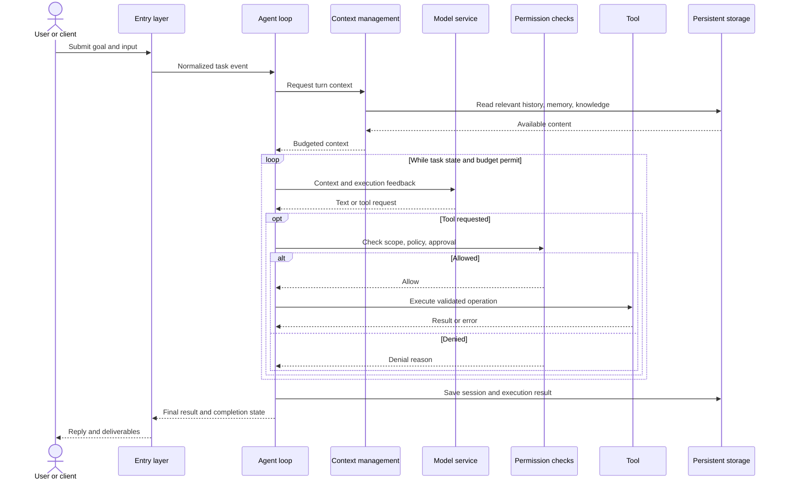

# Architecture

Echo Agent contains a desktop workspace and a standalone runtime. Both connect models, context, and tools through an Agent loop, but use different execution engines and manage configuration and state independently.

## System context

This C4-style context view names system types and responsibilities. Directed solid lines show requests, with responses returning through the interaction. Dashed outer boundaries group usage or deployment scope.

| Area | Desktop | Standalone Runtime |
| --- | --- | --- |
| Entry points | Task UI, coding workspace, expert groups | Terminal, channels, Gateway |
| Engine | In-process Rust engine | Standalone Python engine |
| Host | Windows, workspaces, IDE, local services, lifecycle | Composition, channels, scheduling, service lifecycle |
| Interface | Desktop application | Gateway Dashboard; CLI/TUI |
| Extensions | Embedded tools, Desktop MCP, skills, plugins | Built-in tools, MCP, skills, Python plugins |
| State | Application data and working directories | Instance workspace and storage |

There is no default synchronization of sessions, memory, or configuration. Desktop does not require Python Gateway. Building an application against Gateway is a separate service integration path.

## Runtime components

This view expands Python Runtime only. Solid arrows carry requests or data; dashed arrows show dependencies. Gateway is optional.

| Component | Responsibility | Purpose |
| --- | --- | --- |
| Channel adapters | Normalize input and format replies | Reuse execution while isolating platform differences |
| Gateway | HTTP, WebSocket, authentication, management | Share an instance with browser and application clients |
| Event bus | Dispatch input and output events | Decouple intake, execution, and delivery |
| Agent loop | Coordinate sessions, context, inference, tools, finalization | Turn goals into controlled operations |
| Context management | Select history, memory, knowledge, skills | Fit relevant information into a finite window |
| Models and tools | Request reasoning; validate, approve, execute operations | Separate decisions from actions |
| Persistence | Retain sessions, memory, traces, task state | Enable continuity, inspection, and recovery |

## Task interactions

This UML sequence shows a typical tool-using task. Approval may require user input. Tasks without tools skip that branch. Streaming and progress can arrive earlier; final completion must match actual execution state.

## Lifecycle and operating modes

Startup prepares configuration, models, storage, Agent, channels, and optional services. Shutdown coordinates cancellation, persistence, and cleanup. Foreground execution and Gateway share this lifecycle. Attached CLI/TUI clients do not create another engine.

Usually run one full Runtime per workspace. Define storage, workspace, and credential boundaries before scaling or serving different trust domains. See [Runtime modes](../operations/runtime-modes.md) and [Security](security-model.md).

## Continue reading

[Desktop architecture](desktop-architecture.md) explains local hosting; [Agent loop](agent-loop.md) explains action selection; [Events and delivery](events-delivery.md) distinguishes execution from delivery.
