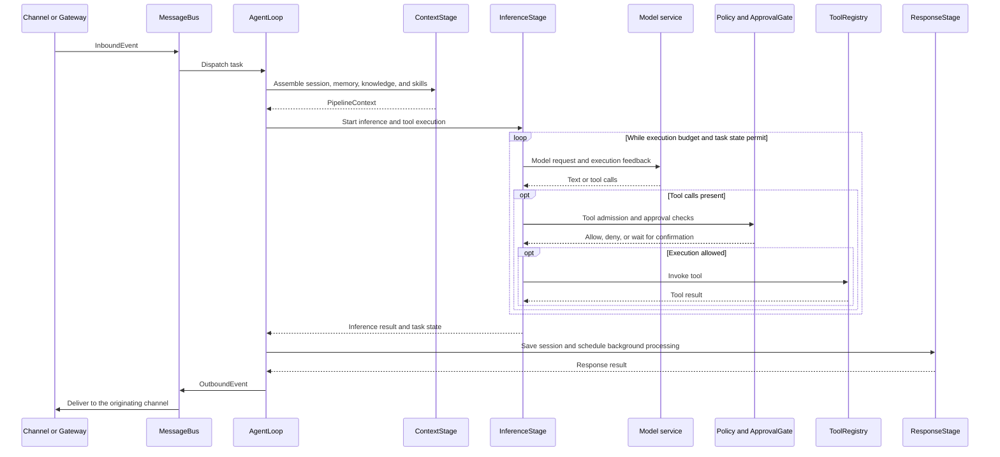

# Architecture Overview

**Echo Agent Runtime is the unified runtime core** of the project. It runs in a terminal, as a Gateway service, or embedded in a host such as `client/`. This page presents the logical architecture, then uses the server implementation in `echo-agent-runtime/` to explain task execution. Client connects to its embedded Runtime over in-process ACP channels, while the host owns the interface and native capabilities. See [Desktop architecture and data flow](https://github.com/fuyuxiang/echo-agent/blob/master/client/README.en.md#architecture-and-data-flow) for Desktop internals.

## Project Boundaries


Use the Runtime through a terminal, messaging channels, or Gateway, or embed it in an application whose host owns the instance and state. Both `echo-agent run` and `echo-agent gateway` start the full Runtime. `echo-agent cli` is an interactive client that connects to an existing Gateway over WebSocket. Commands and configuration determine whether Gateway, channels, tools, and automation are enabled.

Source-level embedding uses `bootstrap` and `AppRuntime` in `echo_agent/app.py`. The host owns component lifecycle, configuration, and workspace management. These interfaces follow the source version; pin it and validate startup, shutdown, and failure cleanup.

## Runtime Components


Solid lines show message exchange; dashed lines show execution dependencies. Components follow configuration. Gateway also holds references to sessions, memory, skills, and tasks for its management APIs; the diagram focuses on task execution.

| Component | Responsibility | Code entry point, relative to `echo-agent-runtime/` |
| --- | --- | --- |
| Application composition | Assemble and manage configuration, storage, models, the Agent, channels, and Gateway | `echo_agent/app.py` |
| Channels and events | Adapt channels, dispatch inbound events, and deliver outbound events | `echo_agent/channels/manager.py` · `echo_agent/bus/queue.py` |
| Execution loop | Coordinate sessions, tasks, context, inference, and tool calls | `echo_agent/agent/loop.py` · `echo_agent/agent/pipeline/` |
| Models and tools | Route providers, make model requests, and register and execute tools | `echo_agent/models/` · `echo_agent/agent/tools/` |
| Memory and knowledge | Recall and consolidate eligible memories; index and retrieve knowledge | `echo_agent/memory/` · `echo_agent/knowledge/` |
| Skills and evolution | Load skills, record trajectories, and validate and promote candidates | `echo_agent/skills/` · `echo_agent/evolution/` |
| Service entry points | Serve aiohttp HTTP/WebSocket, Dashboard, authentication, and management APIs | `echo_agent/gateway/server.py` · `echo_agent/gateway/api/` |
| Persistence | SQLite data and workspace files | `echo_agent/storage/sqlite.py` |

## How a Task Executes

This is a simplified path with tool calls. Streaming events can be emitted during inference; tool and approval branches are skipped when unnecessary.



## Memory and Skill Evolution


- **Memory**: Working supplies current context; Episodic and Semantic retain summaries and facts; Archival retains archived entries. Normal recall follows scope and lifecycle eligibility, excluding archived, superseded, and unresolved entries. Vector retrieval follows configuration.
- **Evolution**: The engine is disabled by default. Once enabled, manual, threshold, or scheduled triggers produce candidates. Risk and configuration route candidates to review or isolated evaluation; only changes that meet the promotion policy reach the live skill library. Rollback of promoted changes is manual.

See the [memory system](memory-system.en.md) and [evolution and evaluation](evolution-evaluation.en.md).

## Services, Extensions, and Permission Boundaries

- **Gateway is a service entry point**: Dashboard, CLI/TUI, and application APIs use the same Runtime. Channels and scheduling also run according to configuration. Normally use one full Runtime per workspace.
- **MCP integrates tools**: The Runtime connects to tool services through its MCP client; local tools, Skills, and Plugins have their own extension points.
- **A2A accepts inbound tasks**: There is no outbound A2A delegation entry point in the current Agent runtime, so diagrams should not show a generic Runtime-initiated peer delegation path.
- **Permissions govern execution**: Tool admission, command policy, and ApprovalGate govern calls. Command policy is not OS-level isolation; actual execution boundaries also depend on the selected executor.
- **State belongs to the deployment**: SQLite and workspace files retain state. Remote models, external MCP servers, and third-party channels receive the content needed for their operations.

## Maintaining the Diagrams

This page and the project README share the bilingual SVGs in `docs/assets/readme/`. After changing code relationships, run from the repository root:

```bash
python3 scripts/generate-readme-diagrams.py
python3 scripts/generate-readme-diagrams.py --check
```

The generator header lists the implementation sources for each diagram. `--check` verifies that artifacts match the generator; module relationships, permissions, and arrow semantics still require review against the implementation.
