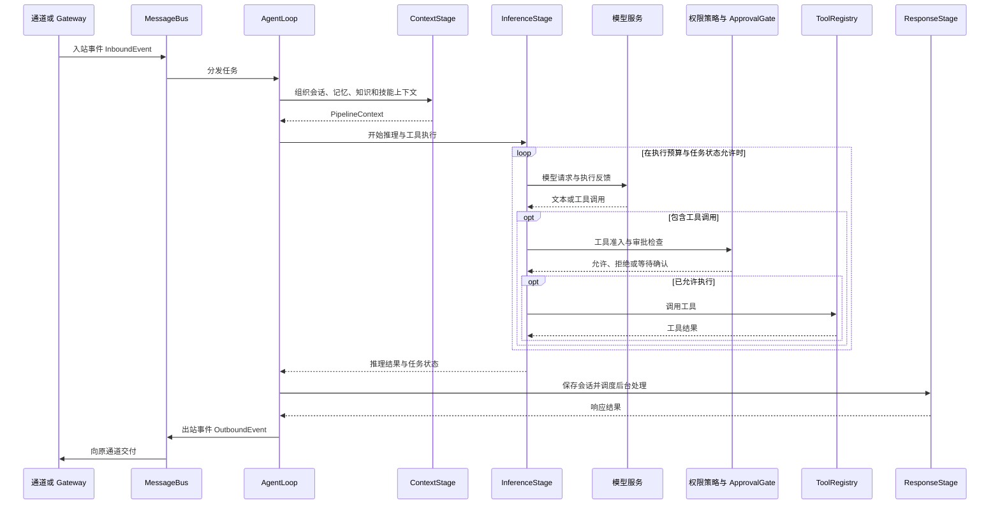

# 架构概览

**Echo Agent Runtime 是项目统一的运行时核心**。它可以在终端运行、作为 Gateway 服务运行，也可以嵌入 `client/` 等宿主应用。本文先描述整体逻辑架构，再以 `echo-agent-runtime/` 的服务端实现说明内部任务链路；Client 通过进程内 ACP Channel 连接内嵌 Runtime，宿主负责界面和本地能力。桌面细节见 [Desktop 架构与数据流](https://github.com/fuyuxiang/echo-agent/blob/master/client/README.md#架构与数据流)。

## 项目边界


Runtime 可通过终端、消息通道和 Gateway 使用，也可嵌入应用，由宿主管理实例与状态。`echo-agent run` 与 `echo-agent gateway` 均启动完整运行时；`echo-agent cli` 通过 WebSocket 连接已运行的 Gateway，属于交互客户端。Gateway 是否启动以及通道、工具和自动化的启用情况由命令与配置共同决定。

源码级嵌入的装配入口是 `echo_agent/app.py` 中的 `bootstrap` 与 `AppRuntime`。宿主需管理组件生命周期、配置和工作区；这些接口随源码版本维护，集成方应固定版本并验证启动、停止及异常清理。

## Runtime 组件关系


图中的实线表示消息交互，虚线表示执行依赖；组件会按配置启用。Gateway 还持有用于管理 API 的会话、记忆、技能和任务组件引用，图中聚焦任务执行路径。

| 组件 | 职责 | 代码入口（相对 `echo-agent-runtime/`） |
| --- | --- | --- |
| 应用装配 | 配置、存储、模型、Agent、通道与 Gateway 的装配和生命周期 | `echo_agent/app.py` |
| 通道与事件 | 通道适配、入站分发、出站交付 | `echo_agent/channels/manager.py` · `echo_agent/bus/queue.py` |
| 执行循环 | 会话、任务、上下文、推理与工具调用的协调 | `echo_agent/agent/loop.py` · `echo_agent/agent/pipeline/` |
| 模型与工具 | Provider 路由、模型请求、工具注册与执行 | `echo_agent/models/` · `echo_agent/agent/tools/` |
| 记忆与知识 | 有效记忆召回、整合，以及知识索引和检索 | `echo_agent/memory/` · `echo_agent/knowledge/` |
| 技能与进化 | 技能加载、轨迹记录、候选验证和晋升 | `echo_agent/skills/` · `echo_agent/evolution/` |
| 服务入口 | aiohttp HTTP/WebSocket 服务、Dashboard、认证与管理接口 | `echo_agent/gateway/server.py` · `echo_agent/gateway/api/` |
| 持久化 | SQLite 数据与工作区文件 | `echo_agent/storage/sqlite.py` |

## 一次任务如何执行

下面是包含工具调用的简化路径。流式事件可在推理期间发出；无需工具或审批时跳过相应分支。



## 记忆与技能进化


- **记忆**：Working 提供当前上下文，Episodic 与 Semantic 保存摘要和事实，Archival 保存归档条目。正常召回遵守作用域与有效性策略，排除归档、已取代和未解决冲突的条目。向量召回按配置启用。
- **进化**：引擎默认关闭。启用后可按手动、阈值或定时方式产生候选；候选按风险与配置进入审核或隔离评估，满足晋升策略才应用到正式技能库。已晋升变更的回滚为手动操作。

详见 [记忆系统](memory-system.md)与 [进化与评估](evolution-evaluation.md)。

## 服务、扩展与权限边界

- **Gateway 是服务入口**：Dashboard、CLI/TUI 和应用 API 可使用同一运行时；通道与调度组件也能按配置运行。同一工作区通常只运行一个完整 Runtime。
- **MCP 是工具集成**：Runtime 通过 MCP 客户端连接工具服务；本地工具、Skills 和 Plugins 也各有独立扩展入口。
- **A2A 是入站入口**：当前 Agent 运行时不提供 A2A 出站委派入口，不能将其画为 Runtime 主动调用其他 Agent 的通用链路。
- **权限控制执行**：工具准入、命令策略和 ApprovalGate 共同控制调用。命令策略不等于操作系统级隔离；实际执行边界还取决于所选执行后端。
- **数据按部署保存**：SQLite 与工作区文件保存状态。使用远端模型、外部 MCP 或第三方通道时，交互所需内容会发送到对应服务。

## 图表维护

本页与项目 README 共用 `docs/assets/readme/` 中的中英文 SVG。修改代码关系后，在仓库根目录执行：

```bash
python3 scripts/generate-readme-diagrams.py
python3 scripts/generate-readme-diagrams.py --check
```

生成器文件头列出了各图对应的代码依据。`--check` 检查产物与生成源码是否一致；模块关系、权限边界与连线语义仍需对照实现审阅。
