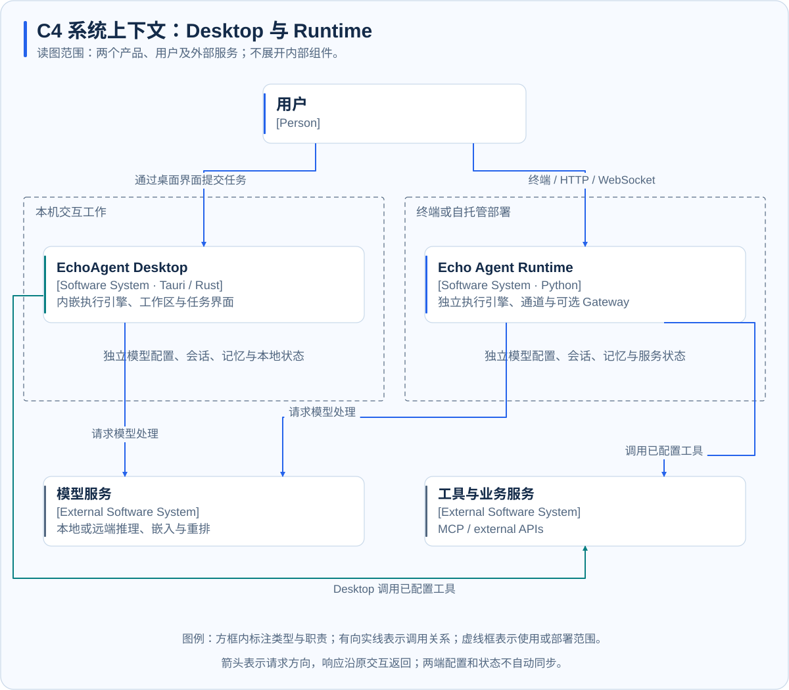
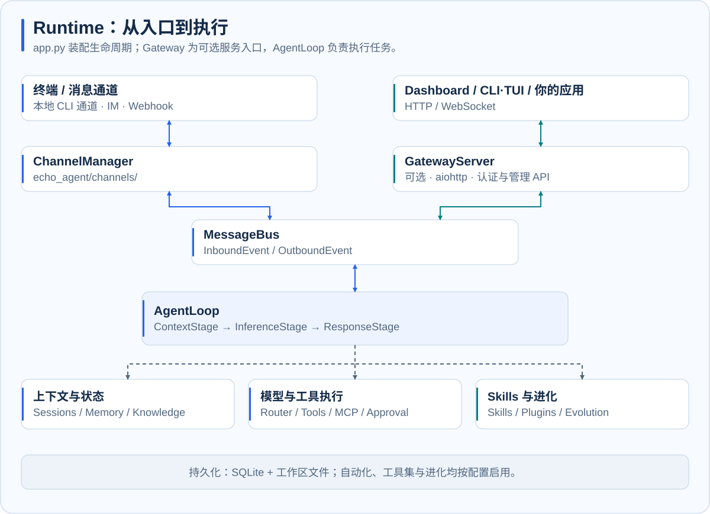
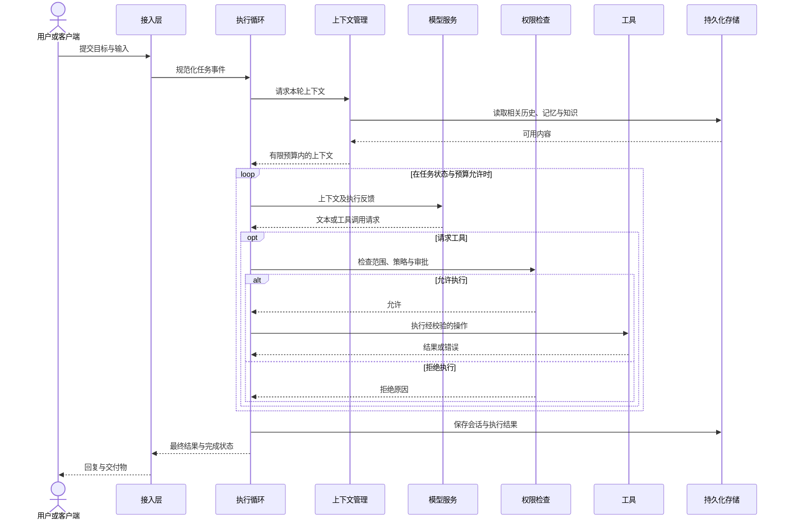

# 架构总览

Echo Agent 包含桌面工作台与独立运行时。两者都以 Agent 循环连接模型、上下文和工具，但当前使用不同的执行引擎，分别管理配置与状态。本页从系统边界解释两端关系，再说明 Runtime 内部职责。

## 系统上下文

这是 C4 风格的系统上下文图。方框标明系统类型与职责，有向实线表示请求方向，响应沿原交互返回。外围虚线框用于标识使用或部署范围。

| 范围 | Desktop | 独立 Runtime |
| --- | --- | --- |
| 主要入口 | 桌面任务界面、代码工作台、专家团 | 终端、消息通道、Gateway |
| 执行引擎 | 应用进程内的 Rust 引擎 | 独立 Python 引擎 |
| 宿主职责 | 窗口、工作区、IDE、本机服务、状态与生命周期 | 组件装配、通道、调度、服务与生命周期 |
| 界面 | 桌面应用 | Gateway 提供的 Dashboard；CLI/TUI |
| 扩展 | 内嵌工具与桌面 MCP、技能、插件 | 内置工具、MCP、技能、Python 插件 |
| 状态 | 本机应用数据与工作目录 | 当前实例的工作区与存储 |

两端没有默认的会话、记忆或配置同步链路。桌面端可以独立运行，不需要先启动 Python Gateway。通过 Gateway 开发自己的应用属于独立的服务集成方式。

## Runtime 组件视图

本图只展开 Python Runtime。实线表示请求或数据流，虚线表示组件依赖；Gateway 为可选组件。各组件职责如下：

| 组件 | 负责什么 | 设计目的 |
| --- | --- | --- |
| 通道适配 | 将平台消息转为统一事件，将结果转回平台格式 | 复用任务处理流程，隔离平台差异 |
| Gateway | 提供 HTTP、WebSocket、认证与管理入口 | 为网页和应用提供同一实例的访问方式 |
| 事件总线 | 分发入站请求与出站事件 | 解耦接入、执行和投递 |
| 任务执行循环 | 协调会话、上下文、推理、工具与收尾 | 将自然语言目标转为受控操作 |
| 上下文管理 | 组合历史、记忆、知识与技能 | 在有限窗口中提供相关信息 |
| 模型与工具 | 请求推理，校验、审批并执行工具 | 将决策与实际操作分开 |
| 持久化 | 保存会话、记忆、轨迹与任务状态 | 支持跨轮次使用、追溯与恢复 |

## 一次任务的交互顺序

该 UML 时序图展示含工具调用的典型任务。审批可能需要用户确认；无需工具的任务跳过工具分支。流式文本与进度可提前返回，最终结果仍需以实际执行状态为准。

## 生命周期与运行方式

Runtime 启动时依次准备配置、模型、存储、Agent、通道与可选服务；停止时协调取消、数据保存和资源释放。前台运行与 Gateway 服务复用这套生命周期。CLI/TUI 连接已有 Gateway，不再创建一套执行引擎。

同一工作区通常只运行一个完整 Runtime，避免多个实例同时写入相同状态。扩容或服务不同信任主体时，先明确工作区、存储和凭据的边界。详见[运行方式](../operations/runtime-modes.md)与[安全模型](security-model.md)。

## 继续阅读

[桌面端架构与数据流](desktop-architecture.md)解释宿主与本机能力的配合；[Agent 循环](agent-loop.md)说明推理如何转为行动；[事件与投递](events-delivery.md)区分执行完成与交付成功。
