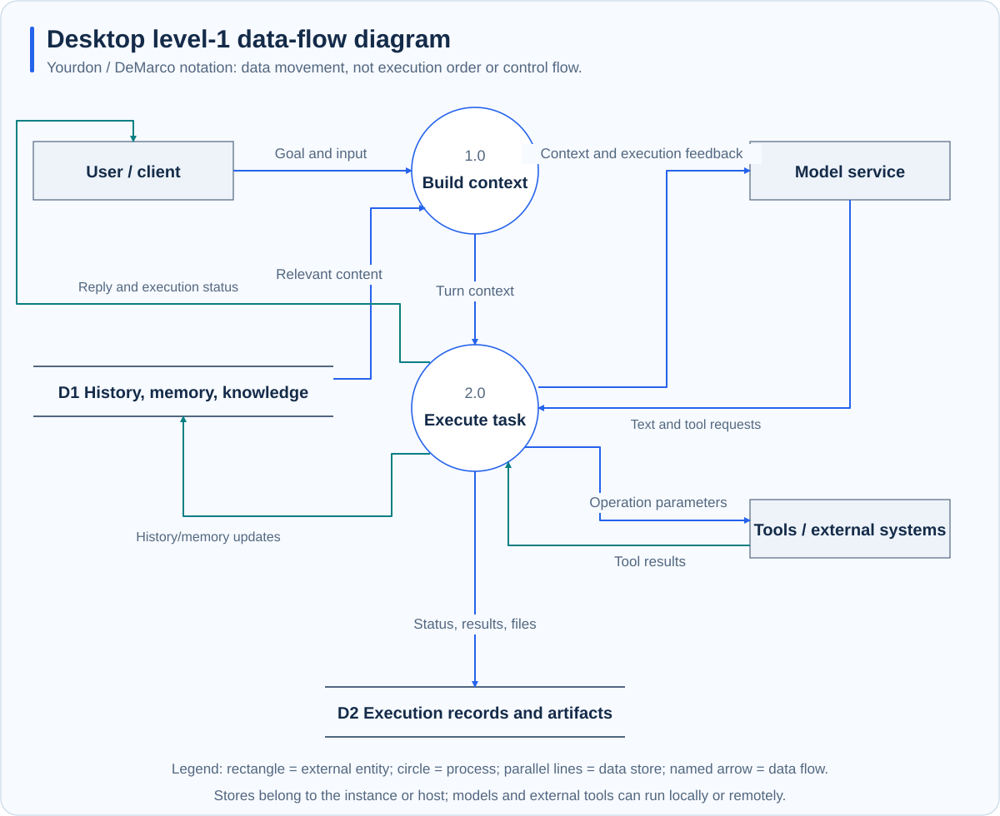

# Desktop architecture and data flow

**Scope: Desktop.** The application consists of UI, host, embedded engine, and local services. The host manages interaction and resources; the engine handles inference and the tool loop. Typed messages carry requests, state, and permission results.

## Components and process boundaries

| Layer | Responsibility | Location |
| --- | --- | --- |
| Task UI | Conversations, plans, approvals, activity, deliverables | Desktop WebView |
| Host | Workspaces, configuration, persistence, lifecycle, system access | Local application process |
| Engine | Context, model calls, tool execution | Dedicated thread in the same process |
| IDE | Editing, terminal, Git, previews | Host-managed local process |
| Office and automation | Document generation, browser and computer actions | Local services or worker processes |
| External dependencies | Models, retrieval, external MCP, business services | Local or remote, as configured |

The host and engine use in-process ACP messaging. Browser and computer capabilities are exposed as task-bound local MCP tools. The host manages the IDE lifecycle; the IDE is not a separate reasoning engine.

## Data movement

This uses Yourdon / DeMarco notation: external rectangles, process circles, parallel-line stores, and named data arrows. Numbers identify processes, not execution order. Grouped stores do not imply identical access permissions.

Goals and selected files enter context. History, memory, and knowledge retrieval supply supporting material. Models return text or tool requests; the execution layer validates and performs operations, then feeds results into subsequent inference. State, history, and deliverables are retained separately.

## Local capability management

The host starts the IDE for an authorized workspace and tracks edits, changes, and verification. Office services generate files locally and return actual paths and receipts. Automation translates page structures, native controls, or screen observations into operations while checking task identity, permission, and target validity.

Capabilities have different conditions. Browser Use needs a detected browser and side-effect confirmation. Computer Use needs explicit task authorization and OS permissions. Task scope, model permissions, and OS access jointly affect the result.

## State and recovery

The host persists task and application state; the engine saves sessions. Expert groups maintain independent member contexts and retain delegation and summary records. Shutdown coordinates service cleanup and persistence, exposing recoverable save failures.

Restart can restore records without replaying interrupted operations. Automation resumes paused; interrupted group work requires inspection. Check actual saves or sends before retrying.

## Data boundaries

Working files and application records are mainly local. Models, embedding, reranking, MCP, and connectors may receive text, file contents, or screenshots. Memory is not automatically shared with standalone Runtime. See the [Desktop guide](../desktop/index.md) for operations.
