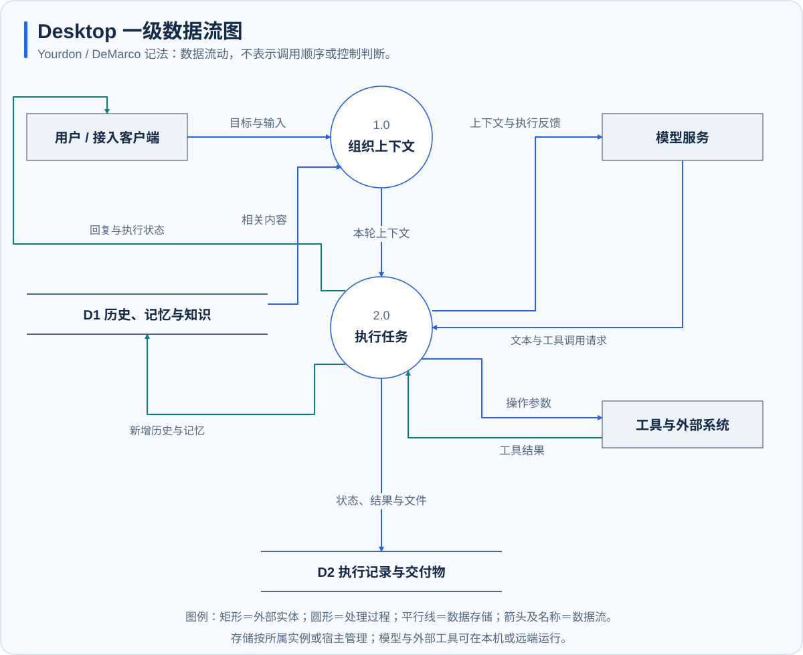

# 桌面端架构与数据流

**适用范围：Desktop。** 桌面端由界面、宿主、内嵌执行引擎和按需启动的本机服务组成。宿主负责用户交互与资源管理，执行引擎负责模型推理和工具循环；两者通过类型化消息交换请求、状态与权限结果。

## 组件与进程边界

| 层次 | 职责 | 运行位置 |
| --- | --- | --- |
| 任务界面 | 展示对话、计划、审批、工具活动与交付物 | 桌面 WebView |
| 桌面宿主 | 管理工作区、配置、状态、生命周期和系统能力 | 本机应用进程 |
| 执行引擎 | 组织上下文、请求模型、协调工具执行 | 同一进程内专用执行线程 |
| IDE 服务 | 编辑、终端、Git 与项目预览 | 宿主管理的本机进程 |
| 办公与自动化服务 | 文档生成、网页和电脑操作 | 本机服务或工作进程 |
| 外部依赖 | 模型推理、检索服务、外部 MCP 与业务系统 | 按配置在本地或远端 |

宿主与执行引擎使用进程内 ACP 消息通道。浏览器和电脑能力通过绑定任务身份的本地 MCP 工具提供。IDE 由宿主管理生命周期，不承担独立的对话推理。

## 数据如何流动

该图采用 Yourdon / DeMarco 数据流记法：矩形是外部实体，圆形是处理过程，平行线是数据存储，箭头标注传递的数据。编号用于标识处理过程，不代表执行顺序。图中合并了同类存储，不表示它们具有相同访问权限。

用户目标与选中的文件进入任务上下文；历史、记忆与知识检索提供补充资料。模型返回文本或工具请求，执行层校验与处理操作，再把结果作为后续推理输入。最终状态、历史和交付物分别保留。

## 宿主如何管理本机能力

代码工作台围绕当前授权工作区启动 IDE，跟踪编辑、差异与验证。办公服务在本机生成文件，向任务返回实际路径与回执。自动化服务将网页结构、原生控件或屏幕观察转换为可操作对象，并检查任务身份、当前权限与操作有效性。

这些服务有不同的执行条件。Browser Use 需要可用浏览器并处理副作用确认；Computer Use 需要明确任务授权和系统权限。任务范围、模型权限与操作系统权限共同影响最终结果。

## 状态与恢复

宿主持久化任务和应用状态，执行引擎保存会话。专家团为每名成员维护独立执行上下文，并保存派发与汇总记录。退出时协调停止服务与保存数据；无法完成保存时保留可恢复错误。

应用重启可以恢复记录，但中断操作不会仅因读取历史而重新执行。自动化恢复为暂停状态，专家团中断工作需要检查，保存或发送类操作应先核对实际结果。

## 数据边界

工作区文件与应用记录主要在本机；模型、嵌入、重排、MCP 和连接器可能接收相关文本、文件内容或截图。两端实现不会自动共享记忆。用户操作与维护方法见 [Desktop 使用指南](../desktop/index.md)。
