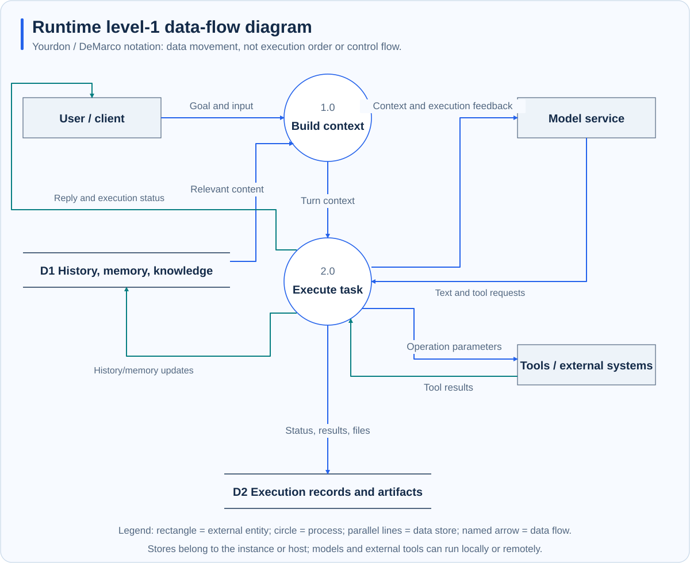

# Events and delivery

**Scope: standalone Runtime.** Platform-specific requests become common events before execution. Common results are then formatted for the destination. This lets terminals, channels, webhooks, and Gateway reuse execution.

## Three kinds of data

| Data | Contents | Purpose |
| --- | --- | --- |
| Inbound event | Source, sender, conversation, text/media, references | Identify task ownership and context |
| Execution state | Stage, tool activity, completion/interruption reason | Show progress and control tasks |
| Outbound result | Destination, text, attachments, delivery information | Return results to an entry point |

Content and authorization are separate. Trusted internal entry points set unattended, scheduled-authorization, and control signals. Message bodies or ordinary metadata cannot by themselves grant authority.

## Data flow

Yourdon / DeMarco notation uses external rectangles, process circles, parallel-line stores, and named data arrows. This diagram does not express concurrency or execution order.

## From request to reply

1. An adapter checks intake identity and conditions and extracts content and references.
2. Channel, session, and scope determine task ownership and queuing.
3. The loop produces replies, tool activity, and final state.
4. Delivery adapts message length, attachments, threads, and updates to the platform.
5. Send results are recorded; failed or partial delivery requires separate handling.

Streaming and final replies serve different purposes. Append-only terminals avoid printing the whole answer twice; editable-message platforms can update a message. Reconnection does not restore arbitrary upstream model streams.

## Three kinds of success

| State | Meaning | Still verify |
| --- | --- | --- |
| Inference ended | A turn result exists | Unfinished work and tool errors |
| Operation succeeded | A tool completed | Artifact content and target state |
| Delivery succeeded | A platform accepted a reply or attachment | Completeness and usability |

If a file was generated but upload failed, report its location and the delivery problem. Model output does not establish receipt. Inspect external state before retrying side effects.

## Delivery boundaries

The event bus primarily dispatches within the running process. It is not a durable message queue and does not promise global exactly-once execution across crashes. Platform retries, interruption, and network failures can leave intermediate state. Use persistent task records, artifacts, and send receipts together.

See [Workspace, session, and identity](workspace-session-identity.md) and [WebSocket protocol](../reference/websocket-protocol.md).
