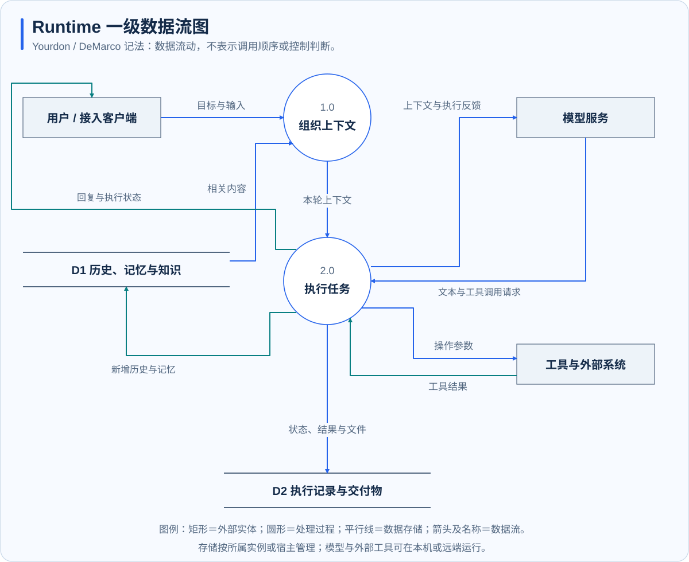

# 事件与投递

**适用范围：独立 Runtime。** 不同平台的请求先转换为统一事件，再进入执行流程。回复也先形成统一结果，再转换为目标平台支持的消息格式。这使终端、消息平台、Webhook 和 Gateway 可以复用执行能力。

## 三类数据

| 数据 | 包含的信息 | 用途 |
| --- | --- | --- |
| 入站事件 | 来源、发送者、会话、文本或媒体、引用关系 | 确定处理对象和上下文 |
| 执行状态 | 当前阶段、工具活动、完成或中断原因 | 展示进度并控制任务 |
| 出站结果 | 目标会话、回复正文、附件与投递信息 | 将结果交付回目标入口 |

消息内容与系统授权分开处理。无人值守、定时任务预授权和控制指令等信任信息由受信任的内部入口设置，不能仅凭外部消息正文或普通附加字段获得授权。

## 数据流

图例采用 Yourdon / DeMarco 记法：矩形为外部实体，圆形为处理过程，平行线为数据存储，箭头标注数据名称。该图表达数据关系，不表达并发程度或执行先后。

## 从请求到平台回复

1. 适配器确认入口身份与接入条件，提取文本、附件和引用信息。
2. 系统根据通道、会话和作用域确定任务归属，排入处理队列。
3. 执行循环产生回复、工具活动和最终状态。
4. 投递层按目标平台能力处理长度、附件、线程和更新方式。
5. 平台返回发送结果；失败或部分失败需要独立记录与处理。

流式更新与最终回复用途不同。只支持追加输出的终端需要避免重复打印完整正文，支持编辑消息的平台则可更新已有消息。网络重连不等于恢复任意上游模型流。

## 区分三种成功

| 状态 | 表示什么 | 仍需检查什么 |
| --- | --- | --- |
| 推理结束 | 已产生本轮结果 | 是否有未完成任务或工具错误 |
| 操作成功 | 某次工具调用完成 | 产物内容和目标状态是否正确 |
| 投递成功 | 接入平台接受回复或附件 | 用户需要的结果是否完整可用 |

文件在本机生成但上传失败时，应报告文件位置和投递问题；不能把“模型生成了回复”当作消息已送达。重试有副作用的任务前，应先核对外部状态。

## 投递边界

事件总线主要承担当前进程内的分发，不等同于持久化消息队列，也不承诺跨崩溃的全局“恰好一次”执行。平台重试、进程中断或网络失败可能留下需要核查的中间状态。重要工作应结合持久化任务记录、真实产物与发送回执判断。

会话和记忆作用域见[工作区、会话与身份](workspace-session-identity.md)，接口格式见 [WebSocket 协议](../reference/websocket-protocol.md)。
