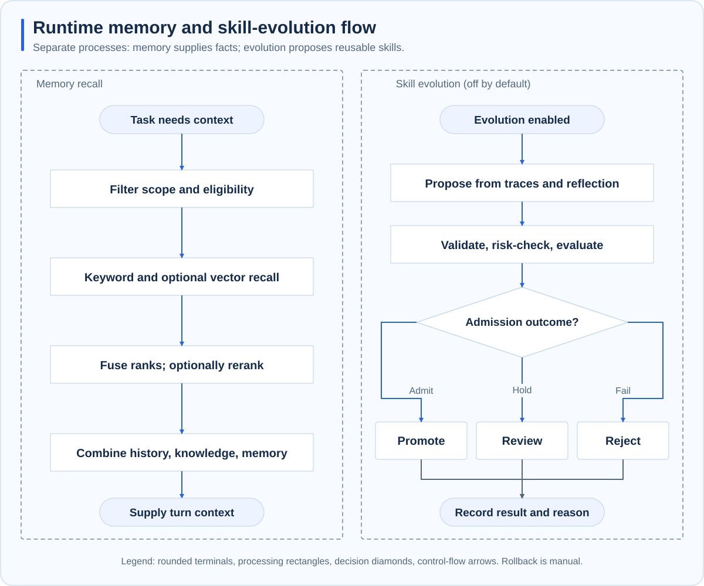
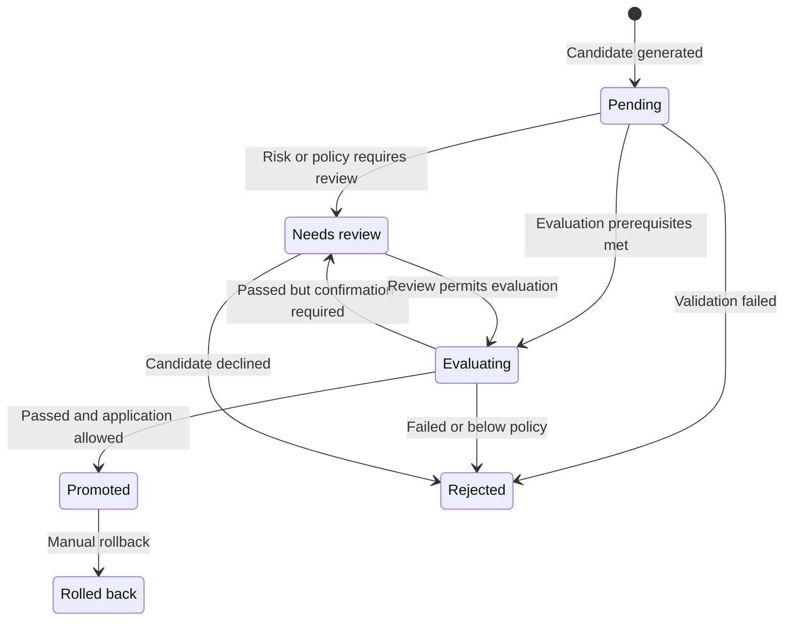

# Skill evolution and evaluation

**Scope: standalone Runtime.** Evolution turns task experience into reusable skill changes. It updates skill content or enabled state, not model weights. It is disabled by default and must be enabled explicitly.

## From experience to candidates

Trajectories retain goals, tool summaries, outcomes, usage, and quality information. Reflection identifies recurring problems or successful methods and proposes skill creation, modification, or disabling. Candidates remain separate from live skills.

Memory recall is on the left and evolution on the right. They manage facts and methods separately.

## Admission and comparison

Candidates undergo format, dependency, and content-risk checks before review or evaluation according to policy. Evaluation compares baseline and candidate skill copies on the same dataset, avoiding direct modification of live skills during experiments.

Evaluation isolation primarily separates skill and evaluation state. It does not establish an OS sandbox for arbitrary third-party tools. Control evaluation tasks and tool scope for the environment.

Promotion considers regressions, quality differences, evaluation reliability, cooldown, and review requirements. Missing datasets, evaluation failures, or changes to the live library prevent blindly applying the original result.

## Candidate lifecycle

This is a conceptual lifecycle. Review handling must still satisfy configured evaluation and promotion conditions. Passing evaluation does not necessarily mean immediate deployment.

## Triggers and rollback

Enabled evolution supports manual, trajectory-threshold, and scheduled triggers. Evaluation adds calls, cost, and runtime. Prepare representative cases before enabling automatic triggers.

Promoted changes support manual rollback using reverse changes or retained snapshots. Restoration failure must be reported. There is no general automatic rollback based on production metrics.

## When to enable it

Use representative repeated tasks, useful traces, evaluations covering real outcomes, and regular review of candidates and regressions. A higher score on one dataset does not establish universal improvement. See [CLI reference](../reference/cli.md) and [Using skills](../integrations/skills/using-skills.md).
