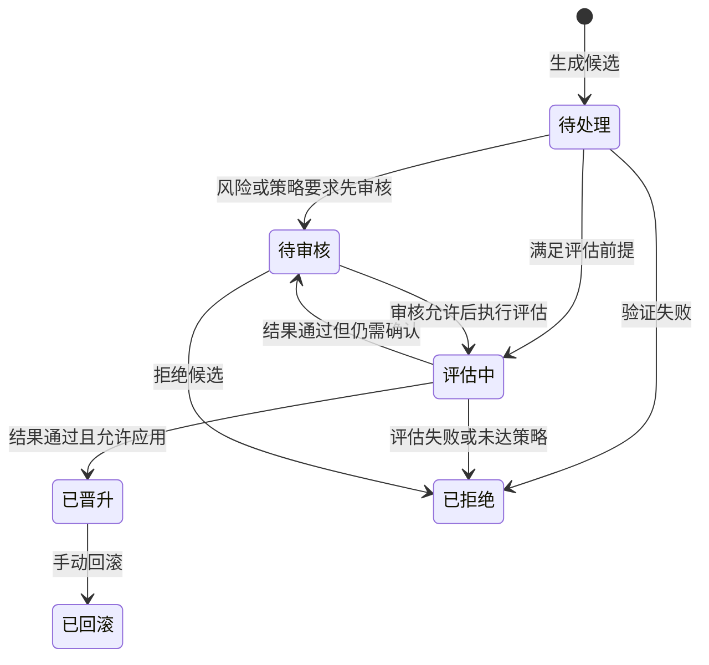

# 技能进化与评估

**适用范围：独立 Runtime。** 技能进化将任务经验整理成可复用的技能改进。它更新技能内容或启用状态，不训练模型权重，也不意味着每次对话都会自动改变行为。引擎默认关闭，需要显式启用。

## 从经验到候选

任务轨迹保存目标、工具调用摘要、结果、用量与质量信息。反思结合这些记录识别重复问题或有效方法，再提出创建、修改、禁用等技能候选。候选与正式技能分别保存，生成候选不等于已经应用。

左侧为记忆召回，右侧为技能进化。两条流程服务后续任务，但分别管理事实与方法。

## 准入与对照评估

候选先接受格式、依赖和内容风险检查，再根据风险与配置进入审核或评估。评估使用技能副本构造基线与候选环境，在相同数据集上比较表现，避免直接把未验证内容写入正式技能库。

评测环境的“隔离”主要指技能和评测状态分离，不应推导为任意第三方工具都处于操作系统安全沙箱。评测任务和工具范围仍需按运行环境控制。

晋升决策结合回归情况、质量差异、评估是否可信、冷却期和人工审核配置。缺少可用数据集、评估失败或正式技能库在评估期间发生变化时，不能按原结论直接应用。

## 候选状态

这是候选生命周期的概念视图；人工审核入口的后续处理仍需满足所配置的评估与晋升条件。“通过评估”不必然意味着立即上线。

## 触发与回滚

启用后可手动触发、按累积轨迹阈值触发或按计划触发。评估会增加模型调用、用量和运行时间，应先准备有代表性的数据集，再逐步开启自动触发。

已晋升变更支持手动回滚。恢复可以利用反向变更或晋升时保留的技能快照；无法恢复时应明确报错，不能把回滚请求视为已成功。当前没有基于线上指标自动撤回技能的通用流程。

## 如何判断是否值得启用

先确认任务类型重复、轨迹质量足够、评估能覆盖关键结果，并且有人定期审阅候选与回归记录。一次评分提高不能证明所有场景改善。手动和自动触发命令见 [CLI 参考](../reference/cli.md)，技能使用见[使用技能](../integrations/skills/using-skills.md)。
