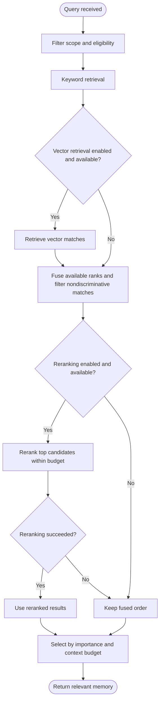

# Memory system

**Scope: primarily standalone Runtime.** Memory turns useful preferences and facts into retrievable context for future tasks. It is managed separately from full chat history, document knowledge, and current task progress.

## Why use layers?

Sending all history increases cost and carries stale or unrelated material into new work. Runtime separates information by use:

| Layer | Content | Purpose |
| --- | --- | --- |
| Working | Short-lived task context | Support the current turn |
| Episodic | Session summaries and provenance | Recall what happened |
| Semantic | Preferences, identity, environment, project facts | Reuse durable knowledge |
| Archival | Records excluded from normal recall | Management, maintenance, inspection |

Layering does not mean all content is saved immediately. Temporary checklists and execution state belong in task records, preventing obsolete progress from becoming durable facts.

## From conversation to facts

After replies, unconsolidated-message thresholds can schedule background summarization, fact extraction, duplicate/conflict checks, and index updates. This is asynchronous; a delivered reply does not establish completed consolidation.

Explicit user statements, extracted facts, model inferences, and migrated data have different provenance. Lower-confidence sources cannot freely overwrite explicit user facts. Write checks also look for suspicious instructions and invisible characters.

## Recall and ranking

Keywords capture exact names and identifiers; vectors add semantic matches. Reciprocal Rank Fusion combines rankings from different retrieval methods. Optional reranking evaluates query-candidate relevance. Embedding and reranking failures can degrade without blocking the whole turn.

Memory vectors and knowledge indexes are separate. Memory vectors carry embedding-model identity; incompatible vectors are re-embedded instead of compared in the wrong semantic space.

## Eligibility, conflict, and forgetting

Normal recall excludes archived, superseded, and unresolved records. Old versions remain inspectable without continuing to influence ordinary answers at a lower weight.

Unused environmental facts lose effective importance over time, while use reinforces retention. Active user identity and preferences are exempt from ordinary time decay. Archiving, version pruning, and deletion have separate maintenance rules.

Conflict handling first selects likely contradictory records, then uses provenance and semantic checks. Unresolved conflicts remain pending rather than presenting incompatible claims as established facts.

## Desktop memory

Desktop has its own embedded memory implementation, with settings, sources, correction, and forgetting. Global preferences, project facts, and group-member memory have separate scopes. Python storage and configuration are not reused automatically. See [Documents, knowledge, and memory](../desktop/knowledge-memory.md).

## Practical interpretation

Use memory for stable facts, knowledge sources for documents, and history for original statements. Verify saved entries, scope, and provenance; a model saying “I remember” is not evidence of persistence. See [Memory management](../guides/memory-management.md).
