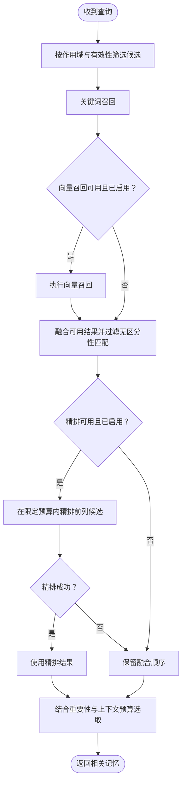

# 记忆系统

**适用范围：本页主要说明独立 Runtime。** 记忆将对话中值得保留的偏好和事实，转为后续任务可检索的上下文。它与完整聊天历史、文档知识库和当前任务进度分别管理。

## 为什么需要分层

把所有历史放进每次请求会提高成本，并把过期或无关内容带入当前任务。Runtime 将信息按使用方式分为四层：

| 层次 | 保存内容 | 对当前任务的作用 |
| --- | --- | --- |
| 工作记忆（Working） | 当前处理所需的短期信息 | 支持本轮上下文组织 |
| 情节记忆（Episodic） | 会话摘要及其来源关联 | 回顾发生过什么 |
| 语义记忆（Semantic） | 偏好、身份、环境与项目事实 | 复用稳定知识 |
| 归档记忆（Archival） | 不再参与正常召回的记录 | 支持管理、维护与追溯 |

分层是信息管理方法，不代表所有内容都会立即进入长期记忆。临时任务清单与执行状态应留在任务记录中，避免旧进度被当作长期事实反复召回。

## 从对话到长期事实

回复后，系统根据未整合消息数量等条件安排后台整合：生成会话摘要，提取有价值的事实，检查重复与冲突，再更新存储和索引。该工作异步执行，发送回复时不要求所有长期记忆已写完。

用户明确陈述、后台提取、模型推断与旧版迁移具有不同来源可信度。较低可信来源不能随意覆盖用户明确提供的事实。写入还会检查可疑指令和不可见字符，减少把外部内容转为长期指令的风险。

## 召回与排序

关键词检索擅长名称、编号等精确线索，向量检索补充语义相近的表达；倒数排名融合（RRF）将不同检索方式的排名组合起来。可选精排再比较查询和候选的相关性。嵌入或精排超时可回退，避免增强能力阻塞整轮响应。

记忆向量与知识库索引是不同存储。记忆向量带有嵌入模型标识；模型改变后，不兼容的旧向量不应继续参与同一语义空间的比较，而需重新嵌入。

## 有效性、冲突与遗忘

正常召回排除归档、已被取代和未解决冲突的条目。旧版本仍可用于管理追溯，但不会以低权重继续混入普通回答。

环境事实会随长时间未使用而降低有效重要性，使用可强化保留；活跃的用户身份与偏好免于一般时间衰减。归档、旧版本清理与删除分别受维护策略约束。

新旧事实发生矛盾时，系统先筛选可能冲突的记录，再结合来源与语义判断处理。无法解决的冲突保留待处理状态，避免把两种相反结论同时作为确定事实提供给模型。

## Desktop 的记忆

Desktop 使用自己的内嵌记忆实现，提供统一设置、来源查看、更正和遗忘。全局偏好与项目事实按用途划分，专家团成员记忆另有范围。它不自动复用本页所述 Python 存储或配置。操作见[文档、知识与记忆](../desktop/knowledge-memory.md)。

## 使用上的判断

长期记忆适合稳定事实，知识库适合有来源的文档，聊天历史适合回查原话。检验记忆时，应检查实际条目、作用域和来源，不宜仅凭模型声称“我记住了”判断写入成功。Runtime 操作见[记忆管理](../guides/memory-management.md)。
