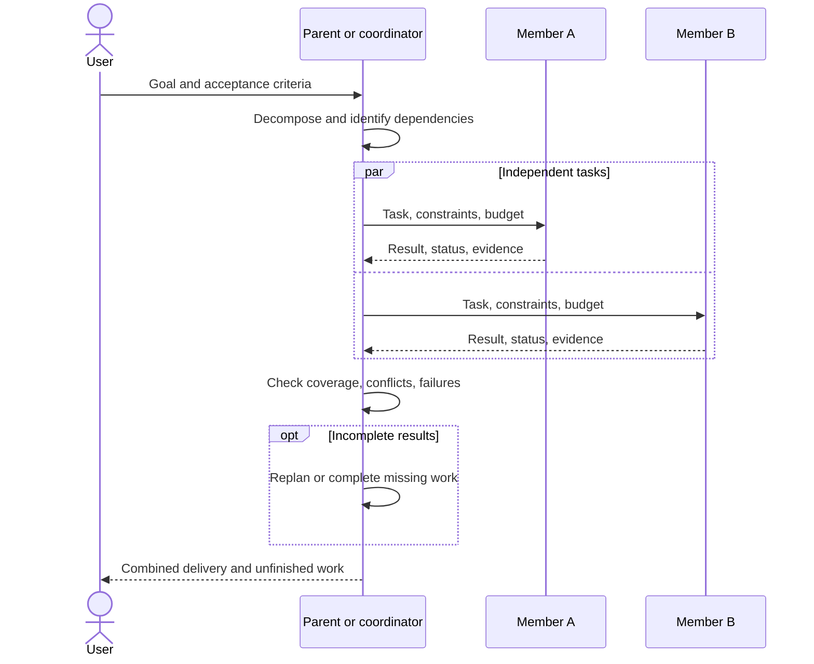

# Multi-Agent collaboration

Multi-Agent work distributes a goal across execution contexts and returns results to a parent or coordinator. It suits clearly scoped, independently verifiable tasks. Shared writes and dependencies still require ordering.

## Runtime Workers

The parent delegates goals through an internal tool. Workers have their own instructions, models, and budgets and return status, text, errors, and usage. The parent checks coverage and produces the final response.

Worker tools cannot exceed the parent's available capabilities. Explicit and role-default tool selections remain subject to execution checks. Depth, concurrency, iteration, and timeout limits bound delegation. Excess tasks in a batch are not guaranteed execution; dispatch in batches and verify coverage.

## Collaboration sequence

The UML parallel fragment applies only where concurrency is allowed. Dependent tasks and shared resource modifications require sequencing.

## Desktop expert groups

The host retains group messages, queues, dependencies, decisions, and summaries over the embedded engine. Members have separate execution and read-only discussion sessions. The host orchestrates work without creating another reasoning kernel.

Groups run up to two members concurrently by default, while execution in the same workspace is serialized. Summaries can resume when results arrive. Interrupted work requires inspection before retry. Shared decisions require confirmation; memory and knowledge follow their own scopes.

## Internal collaboration versus A2A

Workers and groups do not imply a cross-service Agent network. Runtime production A2A support is inbound, with no outbound A2A delegation entry point. External submission, lookup, and cancellation do not turn internal work into remote dispatch.

## Verify collaboration

Check statuses, artifacts, evidence, and missing work for every subtask. Handle failures explicitly. Agreement between members does not replace verification. See [Tasks and planning](../guides/tasks-planning.md) and [Desktop groups](../desktop/collaboration-scheduling.md).
