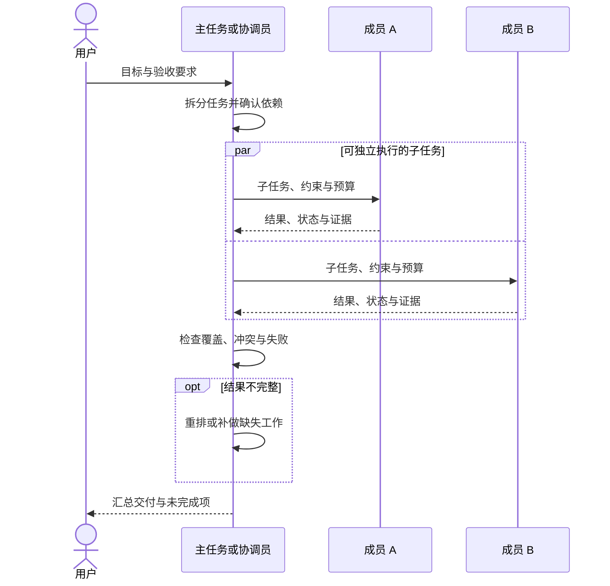

# 多 Agent 协作

多 Agent 将目标拆分给多个执行上下文，再把结果交回主任务或协调员。它适合边界清楚、结果可以独立检查的工作；共享文件写入和依赖关系仍需要顺序协调。

## Runtime 的 Worker 委派

主 Agent 通过内部委派工具提出子任务。每个 Worker 使用独立目标、指令、模型和预算，完成后返回状态、文本、错误与用量。主 Agent 负责检查子任务是否覆盖原目标，再形成最终回复。

Worker 的工具集合不能超出父 Runtime 可用能力；指定工具或使用角色默认工具时仍受执行门控。委派深度、并发数量、迭代和超时限制共同约束执行。超过单批数量上限的任务不会自动保证全部执行，主任务应分批安排并核对结果。

## 协作时序

该 UML 时序图只在独立工作区或允许并发的情况下使用并行片段。依赖前一步结果、修改相同资源的任务需要串行安排。

## Desktop 的专家团

Desktop 在内嵌引擎之上，由宿主保存专家团消息、工作队列、依赖、决定与汇总状态。成员分别拥有执行会话与只读讨论会话；宿主组织协作，不另建推理内核。

默认每个专家团最多并行两名成员，同一工作区的执行工作串行。成员结果到齐后可继续汇总；中断后检查已有工作，再手动重试。共享决定需要确认，成员长期记忆与个人或组织知识由各自范围控制。

## 内部协作与 A2A

内部 Worker 和桌面专家团不等同于跨服务 Agent 网络。Runtime 当前 A2A 生产能力是入站任务服务；当前 Agent 运行时不提供 A2A 出站委派入口。外部调用可以提交任务、查询和取消，但不会使内部委派自动改为远端派发。

## 验证协作质量

主任务应逐项核对子任务状态、实际产物、来源证据与缺失工作。单个成员失败需要被明确处理；多个成员同意某个结论也不能代替事实验证。操作见[任务与规划](../guides/tasks-planning.md)与[桌面专家团](../desktop/collaboration-scheduling.md)。
