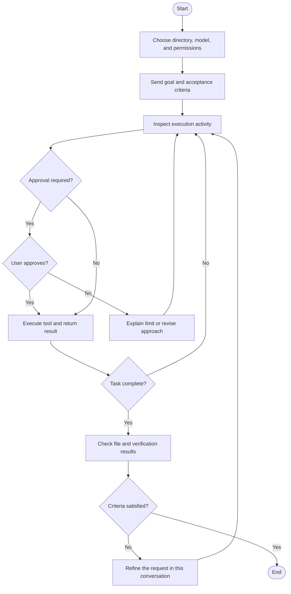

# Desktop quickstart

**Goal: create a file in a chosen directory, open it, and verify the result.** This first task uses Markdown for easy inspection.

## 1. Prepare a working directory

Install and launch the application. Create an empty practice folder, select it on the home screen, choose an available model, and select **Request approval**. The directory identifies the files relevant to this task.

## 2. Submit a precise request

> Create “getting-started.md” in the current working directory with three sections: goal, steps, and acceptance criteria. Create only this file. Report its saved location and read it back to verify its contents.

The request defines scope, output, and verification.

## 3. Inspect progress and approvals

Review the plan, tool activity, and file changes. For approvals, check the operation, directory, and purpose. If you decline, explain an alternative such as a different output location.

Add requirements in the same conversation, for example: “Include the saved location in the acceptance criteria.” Wait for feedback to avoid duplicate submissions.

## 4. Verify the result

- The chosen directory contains “getting-started.md”.
- The file opens with all three sections.
- No unrelated files were changed.
- The response describes execution and verification.

A completion message alone does not establish a correct save. Inspect the Diff and tests for code, open final office documents, and check page state after web submissions.

## Task flowchart

Legend: rounded endpoints mark start and end, rectangles mark processing, diamonds mark decisions, and branches name outcomes.

## Next steps

Read [Tasks and permissions](tasks-permissions.md), then explore [Coding](coding.md), [Office documents](knowledge-memory.md), or [Computer automation](automation.md).
