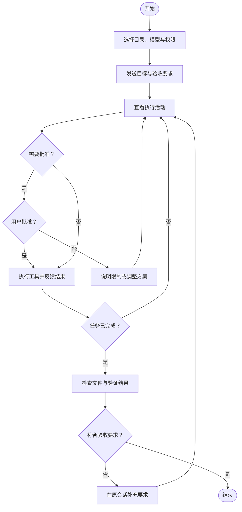

# Desktop 快速开始

**目标：在指定工作目录生成一份可以打开的文件，并核对实际结果。** 首次任务使用 Markdown 输出，便于检查内容。

## 1. 准备工作目录

安装并打开应用，创建一个空文件夹作为练习工作区。在首页选择该目录与可用模型，权限模式选择“请求批准”。工作目录决定本次任务围绕哪些文件开展工作。

## 2. 发送一个明确的任务

> 请在当前工作目录创建“入门清单.md”，包含任务目标、执行步骤和验收标准三个部分。只创建这个文件，不修改其他文件。完成后告诉我保存位置，并读取文件核对内容。

任务同时给出输入范围、输出文件和验收方式，便于判断是否完成。

## 3. 查看执行与权限请求

查看计划、工具活动和文件变更。出现权限请求时，核对操作对象、目录及目的，再决定是否批准。拒绝后可以补充替代方案，例如更换输出位置。

执行中可以在同一会话补充要求，例如“验收标准增加一项：必须说明保存位置”。等待执行反馈，避免重复提交同一任务。

## 4. 验收结果

- 指定目录确实出现“入门清单.md”。
- 文件可以打开，三个部分完整。
- 没有发生要求之外的修改。
- 回复说明了实际执行与验证情况。

只看到“已完成”不足以证明文件已正确保存。代码任务应检查 Diff 和测试结果；办公任务应打开最终文档；网页操作应核对提交后的状态。

## 任务流程图

图例：圆角端点表示开始与结束，矩形表示处理，菱形表示判断；分支标明判断结果。

## 下一步

阅读[任务与权限](tasks-permissions.md)，再按需进入[代码工作台](coding.md)、[办公文档](knowledge-memory.md)或[电脑操作](automation.md)。
